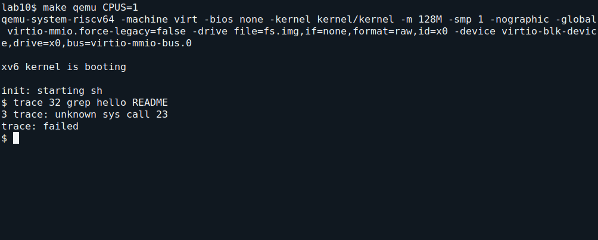
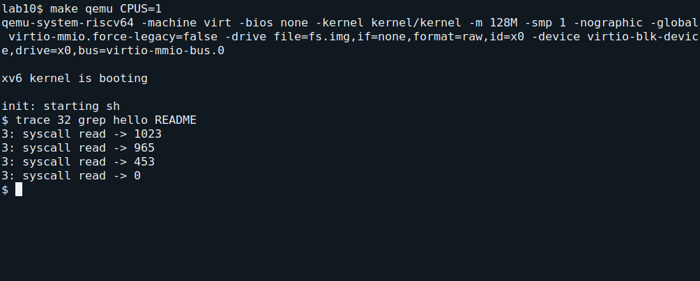
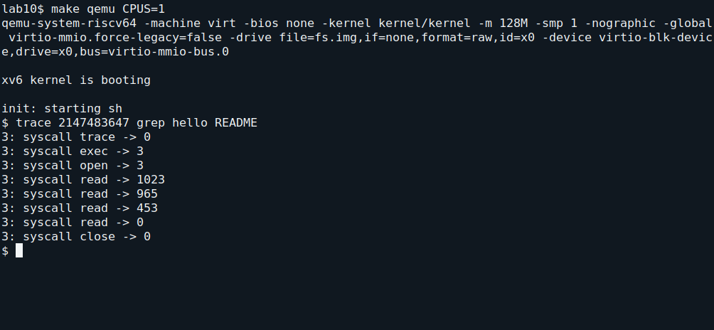
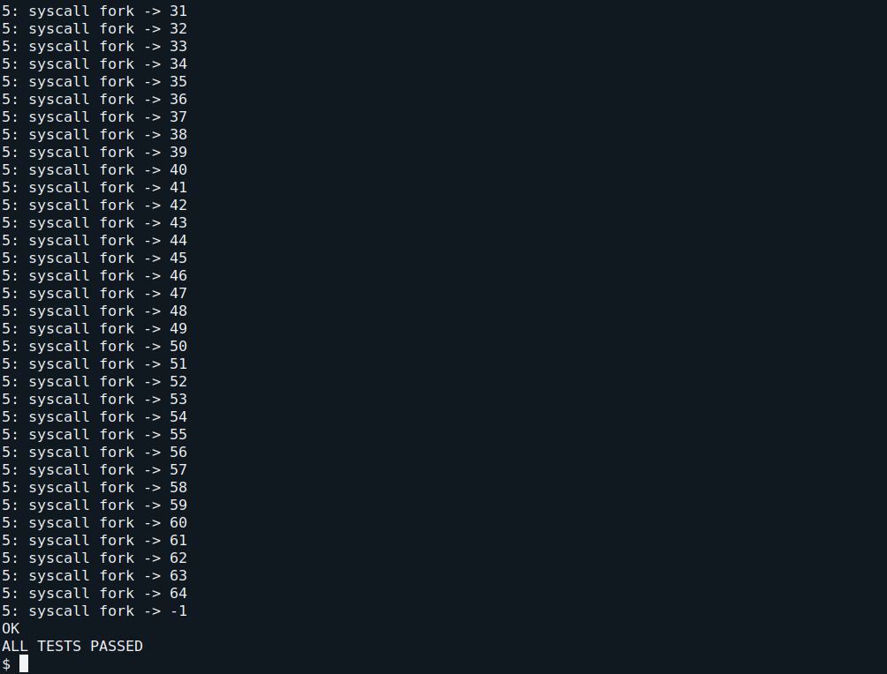
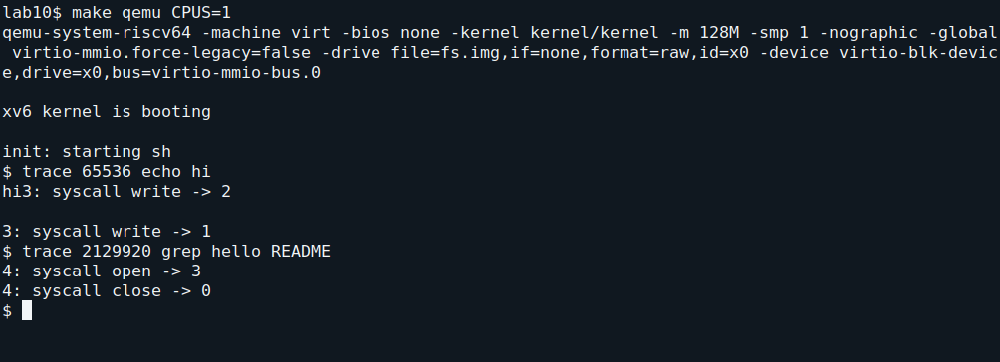
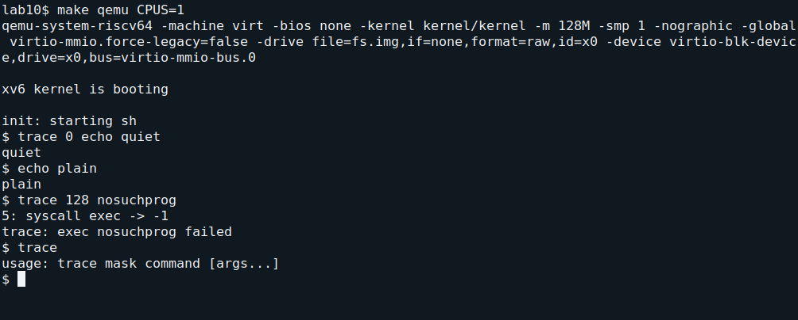

# Laboratory Work No. 10 — Add Your Own System Call: trace

**Student:** Daniil Cerneaga, FAF-243  
**Supervisors:** Marius Dumitrescu; Reițman Patricia  
**Course:** Operating Systems, FCIM, Technical University of Moldova  
**Date:** 15 November 2026

## Purpose and build baseline

This lab adds a kernel service that selects and prints returning xv6 system calls for one process and its descendants. Unlike the external Linux strace experiments, the observations are produced by the modified xv6 syscall dispatcher itself.

The baseline was course revision `06aad25c735fd3159bdfae5680be4eab7b1668b2`, built with RISC-V GCC 15.2.0 and run under QEMU 10.2.1 with one hart and 128 MiB RAM. The Linux host was Ubuntu 26.04.1 under WSL2. In this baseline syscall number **22 is sync**, so the new trace service uses **23**. Kernel output uses **printk**, while user programs use their existing printf/fprintf interfaces.

The modified source tree is in `xv6/`, with its upstream license and Makefile. The four Observe answers are also supplied in notes.txt.

### Sources

Course handout: “Lab 10 — Add Your Own System Call: trace”. The implementation starts from [MIT xv6 revision 06aad25](https://github.com/mit-pdos/xv6-riscv/tree/06aad25c735fd3159bdfae5680be4eab7b1668b2), with the course-specific number 23 and printk interface preserved. The full source tree includes its upstream license.

## Part 1. Following syscall number 23 from user code

Five changes establish the user side and its build registration:

| File | Change |
| --- | --- |
| kernel/syscall.h | Define SYS_trace as 23 after SYS_sync. |
| user/user.h | Declare int trace(int). |
| user/usys.pl | Add entry("trace") to generate its assembly stub. |
| user/trace.c | Set the mask on the current process, then exec the requested command. |
| Makefile | Include $U/_trace in UPROGS after _zombie. |

*Table 1.1 — The first stage's ABI and user-program changes.*

At build time usys.pl generates the stub that puts SYS_trace in a7, executes ecall and returns. The mask argument arrives through the normal argument-register convention. The wrapper then calls exec on argv[2] and forwards the remaining arguments, so the traced command replaces the wrapper within the same process.

### Check 1 — The intentionally incomplete kernel

The first stage was built and booted before adding a kernel handler. This was the actual result:

```text
$ trace 32 grep hello README
3 trace: unknown sys call 23
trace: failed
```




*Figure 1.1 – The kernel receives number 23 before it has a handler.*

The unknown-call message established that the disk program, declaration and ecall stub were connected correctly. It was the expected checkpoint result, not the final implementation.

## Part 2. Dispatch, process state and inheritance

### Per-process mask and handler

`struct proc` now contains an integer trace_mask. The allocation and release paths reset it to zero, making the default state explicit when a process slot is allocated or recycled. sys_trace reads argument 0 with argint, stores it on myproc(), and returns 0:

```c
uint64
sys_trace(void)
{
  int mask;
  argint(0, &mask);
  myproc()->trace_mask = mask;
  return 0;
}
```

*Listing 2.1 — The new syscall handler.*

### Dispatcher registration and post-call printing

`kernel/syscall.c` declares sys_trace, registers `[SYS_trace] = sys_trace`, and defines names for all 23 service numbers. The call is run before its result is printed:

```c
p->trapframe->a0 = syscalls[num]();
if(((uint)p->trace_mask & (1U << num)) != 0)
  printk("%d: syscall %s -> %ld\n", p->pid, syscallnames[num],
         (long)p->trapframe->a0);
```

*Listing 2.2 — Testing an unsigned mask bit after the result is available.*

The unsigned bit operation tests the selected call number without relying on signed right-shift behaviour. The long cast lets failure results be displayed as -1. Since the hook follows the handler, a service such as exit that does not return to this point has no post-return line, even when its bit is selected.

### Fork and exec

The child receives the parent's setting before it becomes runnable:

```c
safestrcpy(np->name, p->name, sizeof(p->name));
np->trace_mask = p->trace_mask;
```

*Listing 2.3 — Copying the mask with the new process's other inherited state.*

exec changes the program image without creating a new struct proc, so the setting persists into grep or echo. A child can subsequently change its own copy; this is process-local state rather than a global trace switch.

### Check 2 — Required read results

```text
$ trace 32 grep hello README
3: syscall read -> 1023
3: syscall read -> 965
3: syscall read -> 453
3: syscall read -> 0
```




*Figure 2.1 – The working kernel traces the four expected read results.*

The positive results sum to **1023 + 965 + 453 = 2441 bytes**, the README size. The final 0 marks end-of-file. grep's input buffering and retained partial lines explain why the intermediate lengths differ; the trace reports what each read actually returned.

## Part 3. Masks and observed behaviour

### All supported bits

```text
$ trace 2147483647 grep hello README
3: syscall trace -> 0
3: syscall exec -> 3
3: syscall open -> 3
3: syscall read -> 1023
3: syscall read -> 965
3: syscall read -> 453
3: syscall read -> 0
3: syscall close -> 0
```




*Figure 3.1 – Enabling all mask bits for grep.*

This run exposed trace, exec, open, read and close. trace itself returned 0 and was printed because its newly stored mask selected it. The successful exec line returned 3 in this implementation: the kernel's exec path returns the new program's argument count, here grep/hello/README. It is not the grep process's eventual exit status. Each line still used the same PID.

### Observe 1 — Why mask 32 hides open and close

**32 = 1 << 5**, and SYS_read is 5. The open and close bits, 15 and 21, remain zero, so those calls still execute but their trace lines are suppressed. Selection controls printing, not whether the syscall itself is allowed to run.

### Observe 2 — Multiple traced PIDs in forkforkfork

`trace 2 usertests forkforkfork` selected SYS_fork, number 1. The selected test completed with **ALL TESTS PASSED**, and the trace included a fork result of -1 when the process table could not supply another child. The enabling line is **`np->trace_mask = p->trace_mask;`**, which copies the selection into the child. Descendants then retain it when they themselves call fork.
This run contained **62 fork trace lines** from **3 distinct calling PIDs**: 3, 4, 5. The exact scheduling and PIDs are run-dependent. The screenshot shows the tail of the stress test and its successful completion.



*Figure 3.2 – Descendant fork tracing reaches table exhaustion and the test passes.*

### Observe 3 — A write trace between hi and its newline

```text
$ trace 65536 echo hi
hi3: syscall write -> 2

3: syscall write -> 1
```

**65536 = 1 << 16**, selecting write. echo first writes the two bytes `hi`, then separately writes the one-byte newline. The hook prints immediately after each write returns, so the first trace line appears after hi but before echo's newline. The observed write results were **2 and 1**. Kernel printk output does not make another user syscall, so printing the trace does not recursively trace itself.

### Observe 4 — The mask for open and close only

The required mask is **(1 << 15) | (1 << 21) = 32768 + 2097152 = 2129920**. The executed test produced only open and close trace names:

```text
$ trace 2129920 grep hello README
4: syscall open -> 3
4: syscall close -> 0
```




*Figure 3.3 – Write-only and open-plus-close masks.*

## Additional checks

Mask 0 ran echo normally with no syscall trace lines. An ordinary `echo plain` after a traced command also remained untraced. A missing executable under mask 128 printed `syscall exec -> -1` followed by the wrapper's error; the no-argument invocation printed usage. A separate status observer confirmed status 1 for both wrapper error cases.



*Figure 4.1 – Zero mask, an untraced command and wrapper error paths.*

The modified kernel can be built with `cd xv6 && make qemu CPUS=1`. The tree has the nine changed or added paths described above. Validation covered the required mask experiments, wrapper error cases and the forkforkfork stress test; the full kernel test suite was not run.

## Conclusion

The implementation connected one new ABI number to an ecall stub, a handler and the dispatch table. Keeping the mask inside each process made tracing survive exec and propagate through fork without enabling unrelated commands. Mask experiments then confirmed both the filtering and the placement of the hook: return values were available, and the trace of echo's two writes appeared exactly between its data and newline.
