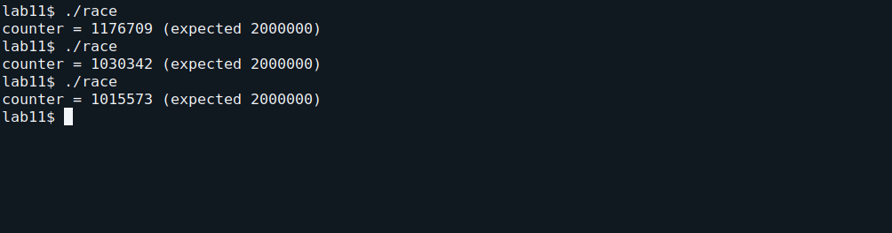
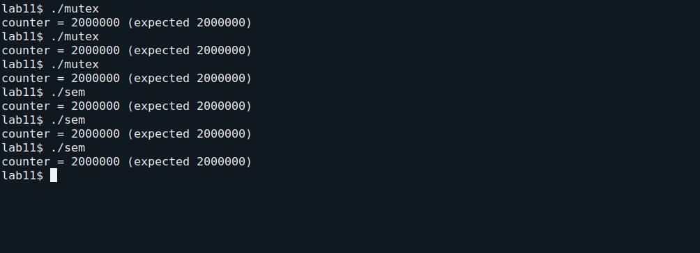
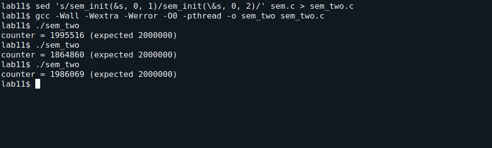
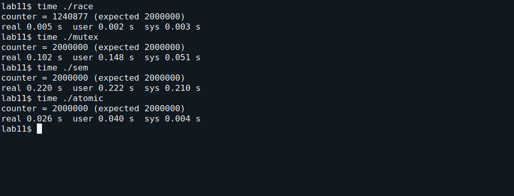
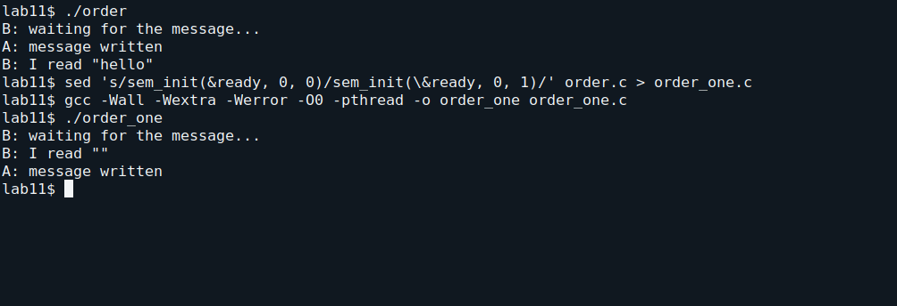
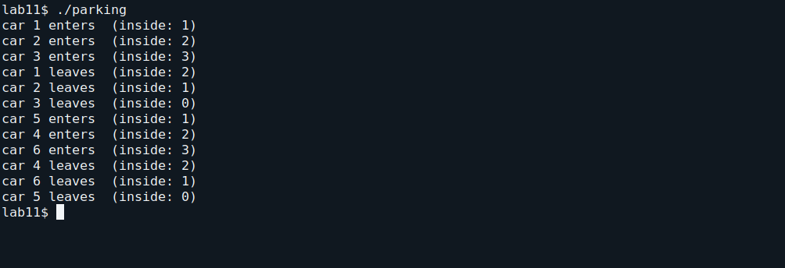
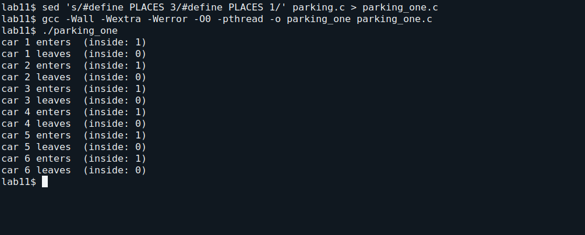

# Laboratory Work 11 — The Race and the Semaphore

**Technical University of Moldova**  
Faculty of Computers, Informatics and Microelectronics  
Department of Software Engineering and Automation

**Course:** Operating Systems — Track A, Linux  
**Student:** Daniil Cerneaga, FAF-243  
**Supervisors:** Marius Dumitrescu; Reițman Patricia  
**Date:** 15 November 2026

## Aim and execution environment

The aim was to observe a lost update, protect the shared counter in two ways, and then use semaphores to control order and capacity. I completed Parts 1–4 and the optional atomic-counter experiment.

The experiments ran in Ubuntu 26.04.1 LTS under WSL2, using Linux 6.18.58.1-microsoft-standard-WSL2 and GCC 15.2.0. This was a real Linux execution with eight available logical processors. The output and screenshots below were collected on 15 November 2026; thread order and timings describe these runs.

All programs were compiled without optimization, as requested. From the `Lab11` directory:

```sh
for name in race mutex sem order parking atomic; do
    gcc -Wall -Wextra -Werror -O0 -pthread -o "$name" "$name.c"
done
```

The programs follow the experiments supplied in the assignment. I added checks for pthread and semaphore errors, retried interrupted semaphore waits, and destroyed synchronization objects after joining the threads. The helper `wait_for()` calls `sem_wait()` and retries only on `EINTR`. Car identifiers point to elements of an array that stays alive until all threads finish.

References: the instructor's *Lab 11 — The Race and the Semaphore*; the [Linux sem_wait manual](https://man7.org/linux/man-pages/man3/sem_wait.3.html); and the [C11 committee draft, section 5.1.2.4](https://www.open-std.org/jtc1/sc22/wg14/www/docs/n1570.pdf). The [Morari Lab 11 report](https://github.com/veacheslavv/os-2026-MorariVeaceslav/blob/main/Lab11/REPORT.md) served as a reference for report layout and figure captions.

## Part 1 — See the race

Each of two threads performs one million increments of a shared `long`. Joining both threads ensures that the main thread prints after they finish, but it does not protect their concurrent updates.

Three consecutive runs returned **1,176,709**, **1,030,342**, and **1,015,573**, instead of 2,000,000.



*Figure 11.1 — Three runs of the unprotected shared counter.*

### Observe 1 — The steps inside counter++

Conceptually, the thread loads the counter, adds one to its local value, and stores that value back. Disassembly of this actual build showed the corresponding instructions:

```asm
mov rax, QWORD PTR [rip + ...]    # load counter
add rax, 1                      # increment the register
mov QWORD PTR [rip + ...], rax   # store counter
```

### Observe 2 — How one addition is lost

Suppose the counter is 7. A loads 7, and B loads 7 before A stores anything. A computes and stores 8. B also computes and stores 8. Two additions were attempted, but the shared counter increased by only one. A mutex must cover the whole read–modify–write sequence.

### Observe 3 — Why runs differ

The threads run with different overlaps and interruptions, so different updates overwrite one another. More precisely, unsynchronized conflicting accesses to an ordinary C object form a data race and give undefined behavior. The lost-update sequence explains the observed build; it is not a portable prediction of every possible result. A run could even print 2,000,000 without making the program correct. `-O0` makes the teaching experiment easier to observe; it does not remove the data race.

## Part 2 — Mutex and semaphore protection

In `mutex.c`, each increment is between `pthread_mutex_lock(&lock)` and `pthread_mutex_unlock(&lock)`. In `sem.c`, the semaphore starts at 1; the corresponding boundaries are `wait_for(&s)` and `sem_post(&s)`. Only one thread can reach the increment at a time.

### Observe 1 — Three runs of each protected program

All three mutex runs and all three semaphore runs returned exactly **2,000,000**. Ten additional executions of each program also produced that result. Both threads were joined before reading the final counter.



*Figure 11.2 — Three mutex runs and three semaphore runs all produce 2,000,000.*

### Observe 2 — Starting the semaphore at 2

I changed only `sem_init(&s, 0, 1)` to `sem_init(&s, 0, 2)` in an experimental copy and rebuilt it. Two permits let both threads enter the increment section together, so the semaphore no longer provides mutual exclusion.

The three results were **1,995,516**, **1,864,860**, and **1,986,069**. The counter again had a data race. A semaphore initialized to 1 acts as a binary lock only when waits and posts are correctly paired; unlike a mutex, it has no owner.



*Figure 11.3 — With two permits, the increment section is no longer exclusive.*

### Observe 3 — The cost of locking

The protected versions coordinate two million updates. Atomic bookkeeping, contention on shared cache lines, and possible blocking and wakeups add work. A lock operation does not necessarily make a system call: an uncontended operation can complete in user space.

I measured one run of each executable with the Bash `time` keyword and `TIMEFORMAT='real %3R s  user %3U s  sys %3S s'`:

| Program | Final counter | Wall time (s) | Correct count |
| --- | --- | --- | --- |
| `race` | 1,240,877 | 0.005 | No |
| `mutex` | 2,000,000 | 0.102 | Yes |
| `sem` | 2,000,000 | 0.220 | Yes |
| `atomic` | 2,000,000 | 0.026 | Yes |

*Table 11.1 — Results and elapsed wall times of the four timed runs.*

These are short local measurements, not universal performance rankings. The race finishes quickly while losing work. The atomic operation was faster than the two lock-based versions here; it still coordinates access to the shared counter. CPU time can exceed wall time because the threads run on multiple processors.



*Figure 11.4 — Actual time output for race, mutex, semaphore and atomic counters.*

## Part 3 — A semaphore as a signal

In `order.c`, `ready` starts at 0. B waits before accessing the message. A sleeps for one second, copies `hello`, prints its message and posts the semaphore. Only then can B pass its wait and read the completed message. The semaphore also supplies the synchronization needed to publish that shared data.

### Observe 1 — Starting ready at 1

The normal run printed the writer's line before B read `hello`. With the initial value changed to 1, B immediately consumed the existing permit and read **an empty string**, before A wrote its message. The global character array initially contains zeros. The delay explains the output observed here, but it is not synchronization; this modified version no longer guarantees safe message access under every schedule.



*Figure 11.5 — Initial value 0 enforces publication order; initial value 1 lets B read too early.*

### Observe 2 — Meaning of an initial value of 0

A semaphore initialized to 0 represents an event or resource that is not yet available: a waiter must wait for a post before proceeding.

The submitted `order.c` restores the initial value to 0. A post made before the reader reaches its wait is retained as a permit, so the reader does not miss the event.

## Part 4 — The parking lot

Six car threads share three places. Each car reserves a permit before entering, stays for one second, and returns its permit after leaving. A separate mutex protects `inside` and the corresponding printed line. The mutex is released while the car is parked, allowing other cars to use the remaining places.

### Observe 1 — Largest occupancy and the enforcing operation

The largest observed value of `inside` was **3**. Initializing `places` with `PLACES = 3` gives three permits, and `wait_for(&places)` — the wrapper around `sem_wait(&places)` — prevents entry when they are all reserved. Each car returns exactly one permit with `sem_post(&places)`. The mutex makes the diagnostic counter consistent; the semaphore limits capacity.



*Figure 11.6 — Six cars finish with no more than three inside and a final occupancy of zero.*

### Observe 2 — Changing PLACES to 1

After rebuilding with `PLACES = 1`, the semaphore admitted only one car at a time. The occupancy alternated between 1 and 0, and all six cars finished. It now acts as a binary semaphore controlling entry to the whole parking interval. The submitted `parking.c` uses three places.



*Figure 11.7 — With one permit, every entry is followed by a departure before the next entry.*

## Optional experiment and conclusion

`atomic.c` uses an `atomic_long` and `atomic_fetch_add()`. Each update is an indivisible atomic read–modify–write operation, so another thread cannot overwrite an increment using a stale value. The timed run and ten additional runs all returned 2,000,000. No explicit lock surrounds the increment.

The same semaphore served three purposes: one permit protected a critical section, zero permits delayed a reader until publication, and three permits limited concurrent occupancy. The initial value alone is not enough: the placement and pairing of waits and posts determine correctness.

The submitted files are `race.c`, `mutex.c`, `sem.c`, `order.c`, `parking.c`, the optional `atomic.c`, and this report with its figures. Experimental changes were not left in the protected programs.
