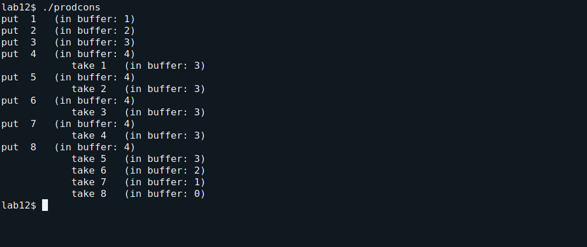
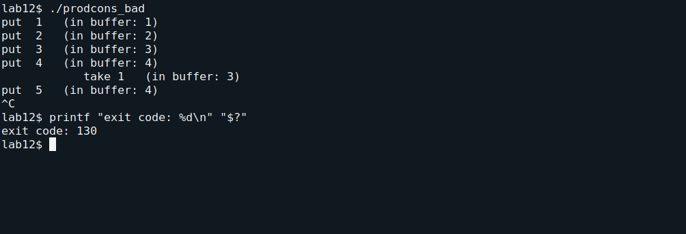
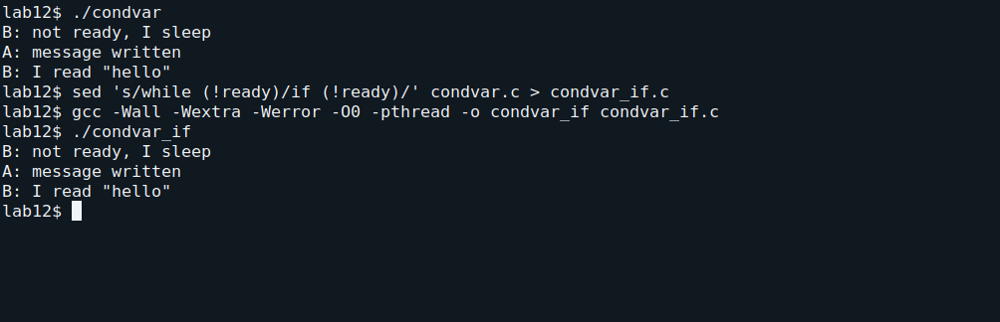
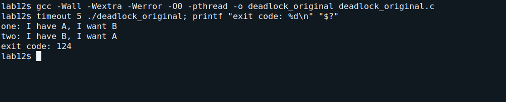
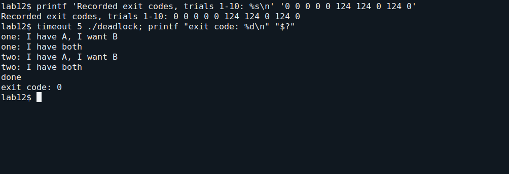

# Laboratory Work 12 — Producer, Consumer and the Other Tools

**Technical University of Moldova**  
Faculty of Computers, Informatics and Microelectronics  
Department of Software Engineering and Automation

**Course:** Operating Systems — Track A, Linux  
**Student:** Daniil Cerneaga, FAF-243  
**Supervisors:** Marius Dumitrescu; Reițman Patricia  
**Date:** 15 November 2026

## Aim and execution environment

This work combines synchronization tools to solve four problems: a bounded producer/consumer buffer, message publication with a condition variable, shared access for readers with exclusive access for writers, and a deadlock removed by consistent lock ordering. I completed all four parts and ran the requested altered versions before restoring the final sources.

The programs ran in Ubuntu 26.04.1 LTS under WSL2, using Linux 6.18.58.1-microsoft-standard-WSL2 and GCC 15.2.0, on 15 November 2026. The screenshots show actual terminal executions. Thread scheduling can change the ordering in a later run.

From the `Lab12` directory, compile the submitted programs with:

```sh
for name in prodcons condvar readers deadlock; do
    gcc -Wall -Wextra -Werror -O0 -pthread -o "$name" "$name.c"
done
```

The sources follow the instructor's examples, with checked pthread/semaphore results, retries for `EINTR` in `wait_for()`, and cleanup after joining the threads. The diagnostic reader count is printed while holding `rlock`, avoiding an additional unprotected read of that counter. `deadlock.c` contains the corrected version, with both threads taking A before B.

References: the instructor's *Lab 12 — Producer, Consumer and the Other Tools*; the [POSIX condition-wait specification](https://man7.org/linux/man-pages/man3/pthread_cond_wait.3p.html); and the [Linux semaphore-wait manual](https://man7.org/linux/man-pages/man3/sem_wait.3.html). The [Morari Lab 12 report](https://github.com/veacheslavv/os-2026-MorariVeaceslav/blob/main/Lab12/REPORT.md) and [Elciscev Lab 12 report source](https://github.com/EXakiToR/os-2026-AndreiElciscev/blob/master/Reports/SO_LaTeX_reports/SO_lab12_report.tex) were references for report structure and presentation.

## Part 1 — Producer and consumer

`prodcons.c` transfers integers 1–8 through a circular buffer with four slots. `empty` starts at 4, `full` starts at 0, and a mutex protects the buffer, indices and occupancy log. The producer reserves a free slot before locking the buffer; the consumer reserves a filled slot before locking it. Indices wrap with modulo `SIZE`.

In the captured run, the producer first filled four slots. The consumer then took the items in FIFO order, 1 through 8, while its 300 ms delay allowed the producer to refill free slots. Occupancy remained between 0 and 4 and ended at 0. Three additional runs also preserved these bounds and transferred every item once, in order.



*Figure 12.1 — Eight items pass through the four-slot FIFO without overflow or underflow.*

### Observe 1 — What stops the fast producer?

`sem_wait(&empty)`, called by `wait_for(&empty)`, blocks when all four permits have been reserved. The consumer posts `empty` after taking an item, allowing the producer to reserve another slot. A full buffer therefore stops insertion until a slot is returned.

### Observe 2 — Who waits at the start?

If it reaches its wait before the first insertion, the consumer blocks at `sem_wait(&full)` because `full` starts at 0. The producer can initially take a permit from `empty`. Starting the consumer thread first makes the wait easy to observe, but does not guarantee that it is scheduled first.

### Observe 3 — Locking before waiting for an empty slot

I swapped the producer's first two synchronization statements in a separate experimental source:

```c
CHECK(pthread_mutex_lock(&lock));
wait_for(&empty);                  /* wrong: may wait while holding lock */
```

This run inserted items 1–4, took item 1, inserted item 5, and then stopped making progress with four items buffered. The producer was waiting for a free slot while holding the mutex. The consumer needed that same mutex to take an item and return a slot. After three seconds I stopped the blocked program with Ctrl-C; the shell reported status 130. The submitted version reserves the slot before taking the mutex.



*Figure 12.2 — The reversed acquisition order blocks with a full buffer; Ctrl-C ends the experiment.*

## Part 2 — The condition variable

`condvar.c` solves the message-ordering problem from Lab 11. The reader acquires the mutex and checks `ready`. `pthread_cond_wait()` atomically releases the mutex and waits, then reacquires the mutex before returning. This lets the writer acquire the mutex, copy `hello`, set `ready = 1`, signal the condition variable and unlock.

### Observe 1 — Which variable remembers readiness?

The ordinary integer `ready` stores the state, and the mutex protects access to it and to the message. `changed` is only a condition variable for waiting and notification; it does not retain a notification as a semaphore permit. If the writer finishes first, the reader sees `ready == 1` and never waits.

### Observe 2 — Replacing while with if

I rebuilt a copy using `if (!ready)`. In this execution it printed the same three lines as the loop version: B slept, A wrote the message, and B read `hello`. This run did not demonstrate an early wakeup, so its success is not evidence that a single predicate check is sufficient.



*Figure 12.3 — The while and if variants both read hello in these particular runs.*

### Observe 3 — Why the predicate must be checked again

A condition wait may return spuriously while `ready` is still 0; the POSIX specification explicitly permits this. More generally, waking says that the state may have changed, not that the predicate is true. The reader must recheck `ready` under the mutex and wait again if necessary. The submitted program uses `while (!ready)`.

## Part 3 — Readers and writers

Three readers share the room, while two writers each add 10 to `value` with exclusive access. `rlock` protects the reader count. The first reader reserves `room`, and the last reader returns it. A writer waits directly on `room` and holds it throughout its update and simulated work.

The captured execution showed writer 1 setting the value to 10, three readers reading 10 with entry counts 1, 2 and 3, and writer 2 setting it to 20. Ten additional normal runs completed with three reader lines and two writer updates. In ten separately instrumented runs, assertions across the simulated work found no writer/reader or writer/writer overlap and observed three readers active together. Those checks support the execution evidence; the protocol explains the exclusion guarantee.


*Figure 12.4 — A group of three readers shares access between two exclusive writer updates.*

### Observe 1 — The first-reader and last-reader rules

The two key fragments of `reader()` are:

```c
if (++readers == 1)
    wait_for(&room);               /* first reader reserves the room */
/* read while the group holds the room */
if (--readers == 0)
    SEM_CHECK(sem_post(&room));    /* last reader returns it */
```

Intermediate readers join the existing group without acquiring another room permit. A writer can acquire the room only when that group has released it. The increments, decrements and associated first/last decisions are all protected by `rlock`.

### Observe 2 — Why readers needs rlock

Without `rlock`, concurrent read–modify–write operations on `readers` could lose updates. The group might release `room` while a reader is still using the data, or fail to release it after everyone leaves. The first/last tests must remain part of the same protected operation as the counter update. The diagnostic read of `readers` also needs protection.

### Observe 3 — A continuous stream of readers

This algorithm favors readers. New readers may join an active group while writer 2 is waiting. If the reader count never falls to zero, the group never releases `room`, and the writer can wait indefinitely: writer starvation. The finite run above completed; it does not establish fairness for an unending workload.

## Part 4 — Create and remove a deadlock

The original experiment takes the mutexes in opposite orders. Thread one holds A and, after a one-second sleep, requests B. Thread two holds B and requests A. I ran that original variant with `timeout 5`: both first-lock messages appeared, neither thread acquired both locks, and timeout ended the process with status **124**.



*Figure 12.5 — Opposite acquisition orders create a circular wait; timeout returns 124.*

### Observe 1 — The wait circle

Thread one holds A and waits for B; thread two holds B and waits for A. Arrows in the following circle alternate between a request and ownership:

```text
thread one --waits for--> B --held by--> thread two
     ^                                      |
     |                                      | waits for
     +--------------held by-- A <------------+
```

Neither thread reaches an unlock, so neither can free the mutex needed by the other.

### Observe 2 — Ten runs without the sleeps

I removed both `sleep(1)` calls from the original, opposite-order variant, rebuilt it and executed it ten times with a five-second limit per run. Status 0 means completion; status 124 means that timeout stopped the program.

| Trial | Exit status | Trial | Exit status |
| --- | --- | --- | --- |
| 1 | 0 | 6 | 124 |
| 2 | 0 | 7 | 124 |
| 3 | 0 | 8 | 0 |
| 4 | 0 | 9 | 124 |
| 5 | 0 | 10 | 0 |

*Table 12.1 — Ten actual runs of the opposite-order variant without sleeps.*

**3 runs timed out** (trials 6, 7, 9), and **7 completed**. Removing the sleeps did not repair the acquisition order; it only changed how often the threads reached the circular wait in this sample. This makes the bug harder to reproduce: a successful test can hide an unsafe interleaving. These counts are observations, not a probability guarantee.

### Observe 3 — Why a common acquisition order fixes this case

If both threads acquire A before B, the thread waiting for A holds neither lock, so the two threads cannot form a circular wait over A and B.

The submitted `deadlock.c` applies that order in both functions and releases B before A. I also corrected thread two's message to say that it holds A and wants B. The final execution printed both success messages, `done`, and status **0**. The sleeps remain in place, demonstrating that correctness comes from lock order rather than from removing a delay.



*Figure 12.6 — Recorded no-sleep trial statuses and a successful run of the submitted fixed version.*

## Conclusion

The buffer needs both resource counts and exclusive access to its state. A condition variable needs a separate, mutex-protected predicate. Reader grouping permits simultaneous reads but does not guarantee writer fairness. Finally, both deliberately blocked examples held a resource while waiting for progress that required another thread to acquire it. Reserving buffer capacity before taking its mutex and using one common order for A and B removed those cycles.

The submitted programs are `prodcons.c`, `condvar.c`, `readers.c`, and the fixed `deadlock.c`, together with this report and its figures. The altered producer, single-check reader and opposite-order deadlock programs were used only for the experiments described above.
