# Laboratory Work No. 3 — The Command Line: Shell, Pipes and Text Filters

**Student:** Daniil Cerneaga, FAF-243  
**Supervisors:** Marius Dumitrescu; Reițman Patricia  
**Course:** Operating Systems, FCIM, Technical University of Moldova  
**Date:** 12 November 2026

## Purpose, environment and data

This lab examines what Bash does before a program starts, how descriptors connect commands, and how text filters answer questions about a log. The experiments used Ubuntu 26.04.1 under WSL2 as the ordinary account `deventeex`, with `LC_ALL=C`. The interactive shell had no profile aliases and used a six-entry Linux PATH. Terminal screenshots show real Bash sessions; command outputs and PIDs describe this run.

The log is the artificial dataset specified by the course, not a record of live web traffic. Its date remains 2026-10-05 even though these experiments were performed on 12 November. It was generated before the filters were run:

```bash
for i in $(seq 1 500); do
  echo "2026-10-05 10:$(printf %02d $((i % 60))) user$((i % 7)) $([ $((i % 5)) -eq 0 ] && echo FAIL || echo OK) /page$((i % 4))"
done > access.log
head -3 access.log
wc -l access.log
```

The generator produced 500 lines. The submitted `oneliners.sh` expects `access.log` in its current directory; `report.sh` accepts the path as an argument. Predictions for Part 2 and Q8 were recorded before executing those commands.

## Part 1. Finding commands and using help

Tab completed `/usr/sh` to `/usr/share/` and `/et` to `/etc/`. After running `pwd`, `whoami` and `uname -s`, Ctrl+R followed by `whoa` retrieved the earlier `whoami` command. These are Readline editing operations in Bash, rather than services implemented by `ls` or `cd`.

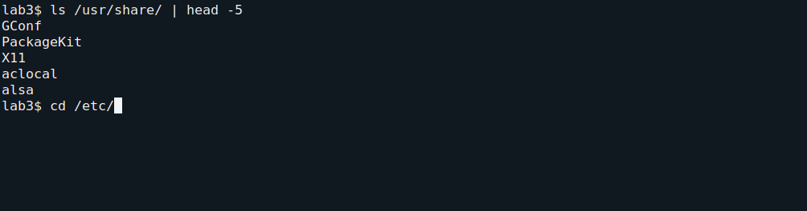

*Figure 1.1 – Tab completion of /usr/sh and /et.*

### Observe 1 — Built-ins and external programs

`type` identified `cd` and `echo` as shell built-ins, and `ls` as `/usr/bin/ls`; `which ls` confirmed that executable path. `cd` must affect the shell process itself: changing a separate child's current directory would leave the parent shell in its old directory. Bash also provides a built-in `echo`, although an external executable with the same name can exist.

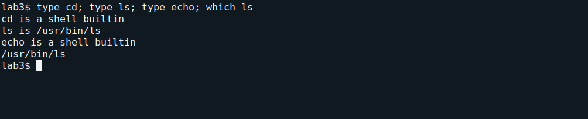

*Figure 1.2 – Output of type and which.*

### Observe 2 — PATH

This session's PATH had six directories: `/usr/local/sbin`, `/usr/local/bin`, `/usr/sbin`, `/usr/bin`, `/sbin`, and `/bin`. `ls` was found at `/usr/bin/ls`. The current directory was not an entry, which later explains the `./report.sh` invocation.

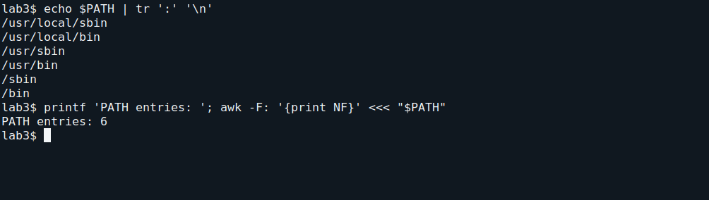

*Figure 1.3 – PATH directories and their count.*

### Observe 3 — Missing command

`nosuchprog` was not found and returned status 127. The status was read immediately using `$?`; running another command first would replace that value.

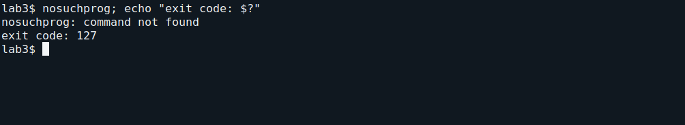

*Figure 1.4 – Exit status of a missing command.*

### Observe 4 — Help and modification-time sorting

The `ls` option for sorting by modification time is `-t`, newest first. The help exercise used `man ls`, searched for `sort`, advanced to the next match with `n`, and exited with `q`. `ls --help | head`, `man -k "list directory"`, and `help cd` provided short help, a manual-description search and help for a shell built-in respectively.

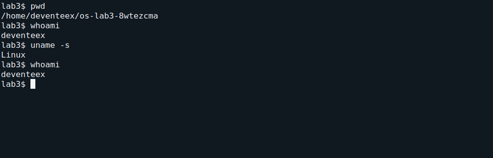

*Figure 1.5 – Retrieving whoami with reverse history search.*


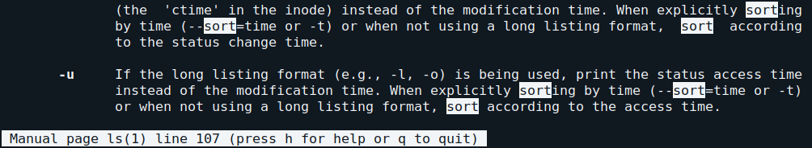

*Figure 1.6 – Searching the ls manual for sorting options.*


## Part 2. Expansion and quoting

The test directory contained `a.c`, `b.c`, `file1.txt`, `file2.txt`, `notes.txt`, and the single filename `alfa beta.txt`.

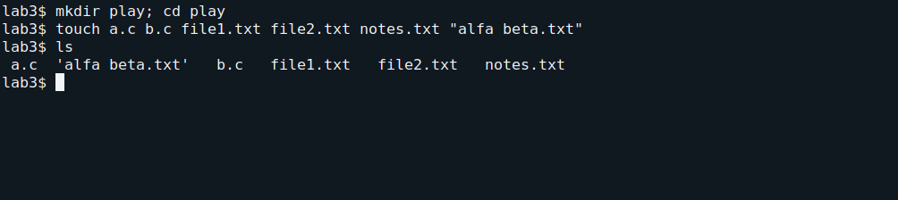

*Figure 2.1 – Files created for expansion experiments.*

### Observe 1 — Prediction compared with execution

Each row's prediction was written before the command ran. Semicolons in the Actual column separate output lines. The last column explains the shell operation, including why an expected error occurs.

| Command | Prediction | Actual output | Interpretation |
| --- | --- | --- | --- |
| `echo *.c` | a.c b.c | a.c b.c | Bash expands the two matching C filenames. |
| `echo file?.txt` | file1.txt file2.txt | file1.txt file2.txt | `?` matches one character; both numbered names match. |
| `echo [a-b]*` | a.c alfa beta.txt b.c | a.c alfa beta.txt b.c | The range matches names beginning with a or b, including the name with a space. |
| `echo *.xyz` | *.xyz | *.xyz | With nullglob disabled, an unmatched pattern remains literal. |
| `ls alfa beta.txt` | Two errors: alfa and beta.txt do not exist | ls: cannot access 'alfa': No such file or directory; ls: cannot access 'beta.txt': No such file or directory | Unquoted whitespace creates two arguments, neither of which names a file. |
| `ls "alfa beta.txt"` | 'alfa beta.txt' (terminal quoting) | 'alfa beta.txt' | The quotes preserve one argument; ls adds display quotes around this filename. |
| `echo '$HOME' "$HOME" \$HOME` | $HOME /home/deventeex $HOME | $HOME /home/deventeex $HOME | Only the double-quoted variable is expanded. |
| `echo {1..5} ; echo $((7 * 6))` | 1 2 3 4 5; then 42 | 1 2 3 4 5; 42 | Brace expansion creates five words; arithmetic expansion computes 42. |
| `echo "today is $(date +%A), I am $(whoami)"` | today is Thursday, I am deventeex | today is Thursday, I am deventeex | Command substitution inserts the current weekday and account name. |
| `touch log{1..3}.txt && ls log*` | log1.txt log2.txt log3.txt | log1.txt  log2.txt  log3.txt | Brace expansion creates three files; the final glob lists them. |

*Table 2.1 — Predictions and actual expansion results.*


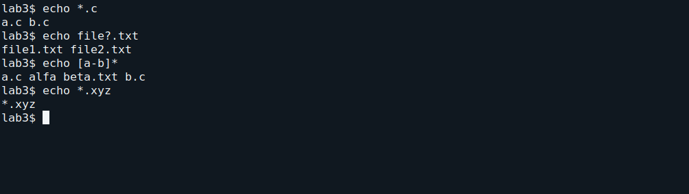

*Figure 2.2 – Matching and unmatched filename patterns.*

### Observe 2 — Who expanded the filenames?

Bash replaced `*.c` with matching filenames before calling `echo`. The command received ordinary arguments; it did not need to inspect the directory or interpret a wildcard.

### Observe 3 — The filename containing a space

`ls alfa beta.txt` requested two names and failed. Both `ls "alfa beta.txt"` and `ls alfa\ beta.txt` pass the intended single filename. The display quotes added by this system's `ls` distinguish a name containing spaces from several separate names; they are not characters in the stored filename.

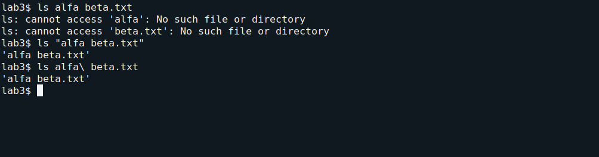

*Figure 2.3 – An unquoted name, quoted fix and escaped-space fix.*

### Observe 4 — Single quotes, double quotes and backslash

Single quotes preserve the text literally. Double quotes preserve an argument's boundaries while allowing variable, command and arithmetic expansion. A backslash protects the following character here, so `\$HOME` is literal. The observed output was `$HOME /home/deventeex $HOME`; the brace/arithmetic example printed `1 2 3 4 5` followed by `42`.

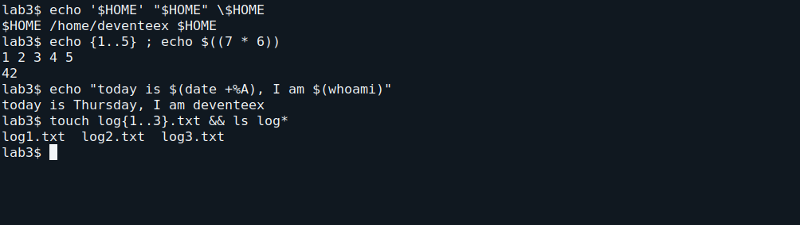

*Figure 2.4 – Quoting, arithmetic and command substitution.*


## Part 3. Redirection, command lists and jobs

### Observe 1 — Separating standard output and errors

`ls /etc /nope > out.txt 2> err.txt` sent the directory listing to `out.txt` and the missing-path diagnostic to `err.txt`. Descriptor 1 is stdout and descriptor 2 is stderr. The missing path still made `ls` fail even though its output streams were successfully redirected.

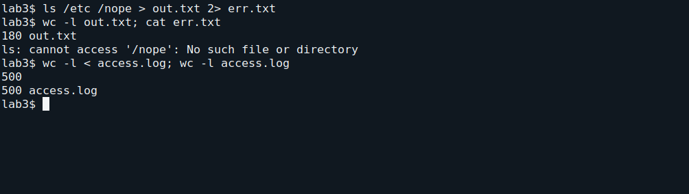

*Figure 3.1 – Separate stdout and stderr, and wc with two input forms.*

### Observe 2 — Redirection order

In `> all.txt 2>&1`, stdout is opened on the file first and stderr is then duplicated from that descriptor, so both streams go to the file. In `2>&1 > all.txt`, stderr first retains the terminal destination of the original stdout; redirecting stdout afterwards does not change that saved descriptor. Consequently the second form displays the error in the terminal while the listing goes to `all.txt`.

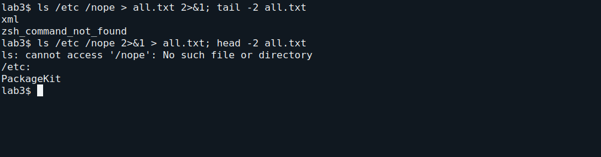

*Figure 3.2 – Comparing the order of descriptor redirections.*

### Observe 3 — Why wc sometimes prints a filename

`wc -l < access.log` reads descriptor 0 and prints just `500`. In `wc -l access.log`, the pathname is an argument to `wc`, so its result also identifies the file. Appending with `>>` preserved the first line in `notes.md`, while `>` initially created or truncated it.

### Observe 4 — The command-list operators

`;` runs the next command after the previous one finishes regardless of its status. `&&` runs the following command only after success. `||` runs it only after failure, which is why the missing-path example printed `failed with code 2`.

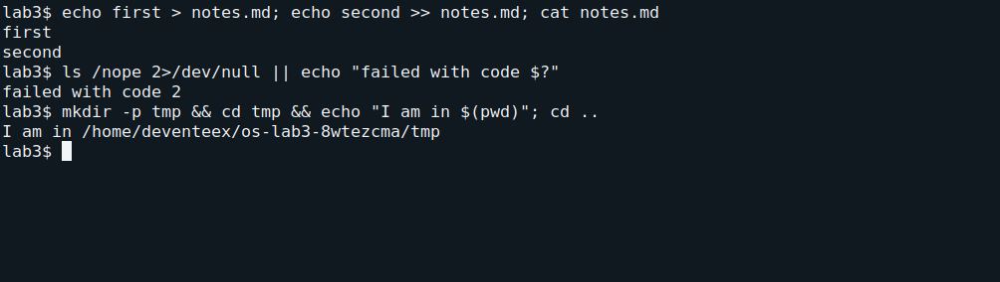

*Figure 3.3 – Append, conditional execution and directory changes.*

`sleep 100 &` started a background job. `jobs` identified it through the shell's job table, `kill %1` targeted that job, and `wait %1` reaped it. A shell job number such as `%1` is different from the kernel PID.

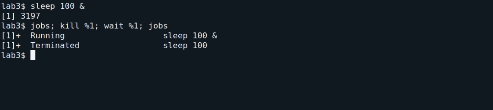

*Figure 3.4 – Starting, inspecting and terminating a background job.*


## Part 4. Eight questions answered by one-liners

The complete commands are in `oneliners.sh`, one executable line per question. The filters use fields rather than matching fragments of usernames. Q4 retains every user tied for the maximum, rather than selecting an arbitrary first row.
### Q1 — Failed requests


```bash
grep -c ' FAIL ' access.log
```

There were **100** failed requests.

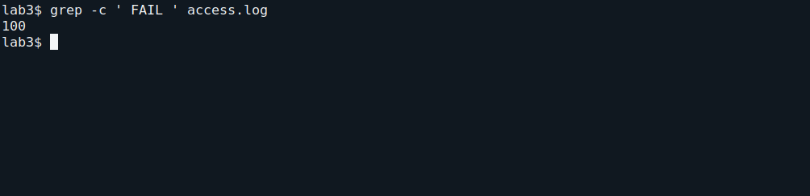

*Figure 4.1 – Failed requests.*

### Q2 — Distinct pages


```bash
cut -d' ' -f5 access.log | sort -u | awk '{print; count++} END {print count " distinct pages"}'
```

There were **four** pages: `/page0`, `/page1`, `/page2`, and `/page3`.

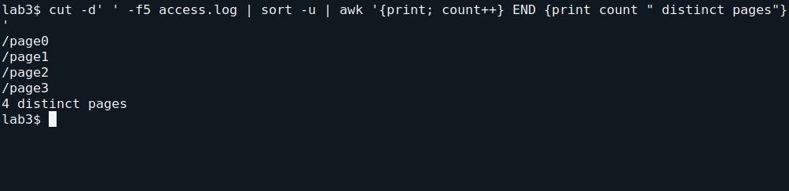

*Figure 4.2 – Distinct pages.*

### Q3 — Requests per page


```bash
cut -d' ' -f5 access.log | sort | uniq -c
```

Each page received **125** requests. The four counts add to 500.

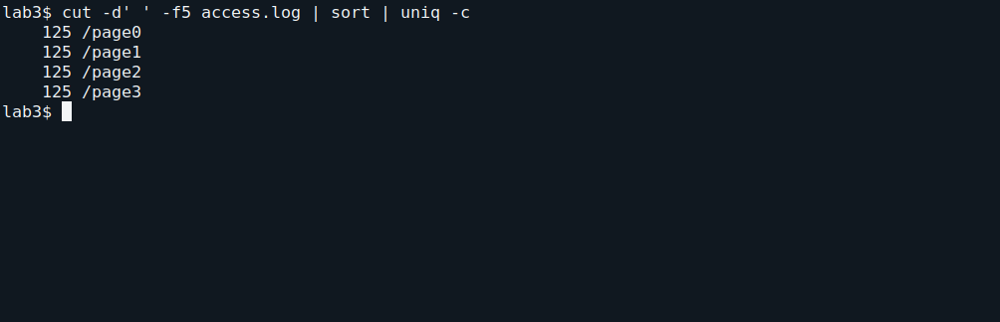

*Figure 4.3 – Requests per page.*

### Q4 — Users with the most failures


```bash
grep ' FAIL ' access.log | cut -d' ' -f3 | sort | uniq -c | sort -k1,1nr -k2,2 | awk 'NR==1 {maximum=$1} $1==maximum {print $2, $1}'
```

Both **user3 and user5** had **15** failed requests. Each other user had 14; all seven failure counts add to 100.

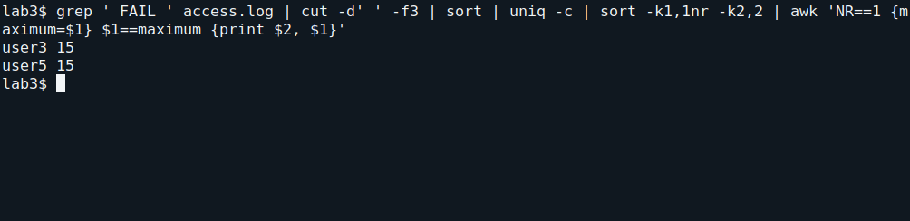

*Figure 4.4 – Users with the most failures.*

### Q5 — Requests made by user3


```bash
awk '$3=="user3" {total++; if($4=="FAIL") failed++} END {printf "user3: %d requests, %d failed\n", total, failed}' access.log
```

**user3 made 72 requests, including 15 failures.**

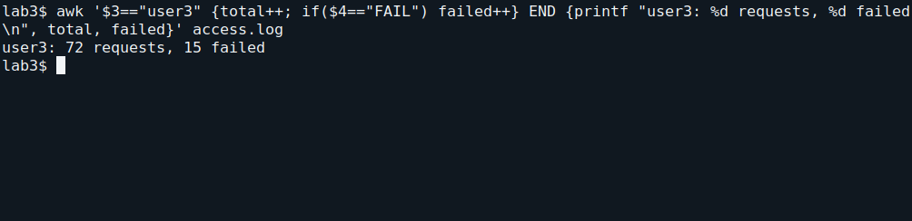

*Figure 4.5 – Requests made by user3.*

### Q6 — The last three failures


```bash
grep ' FAIL ' access.log | tail -3 | cut -d' ' -f2,3
```

In file order, the last three failed requests were `10:10 user0`, `10:15 user5`, and `10:20 user3`. “Last” refers to log order, not sorting the recurring minute field.

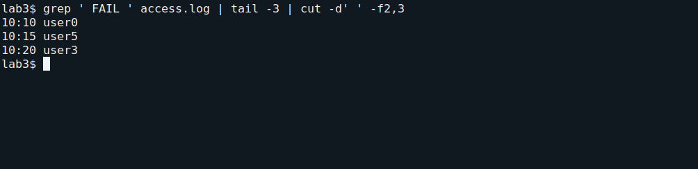

*Figure 4.6 – The last three failures.*

### Q7 — Login-shell counts


```bash
cut -d: -f7 /etc/passwd | sort | uniq -c
```

The seventh colon-separated field gave 2 accounts using `/bin/bash`, 1 using `/bin/false`, 1 using `/bin/sync`, and 23 using `/usr/sbin/nologin`. These are account configuration values, not a list of currently running shells.

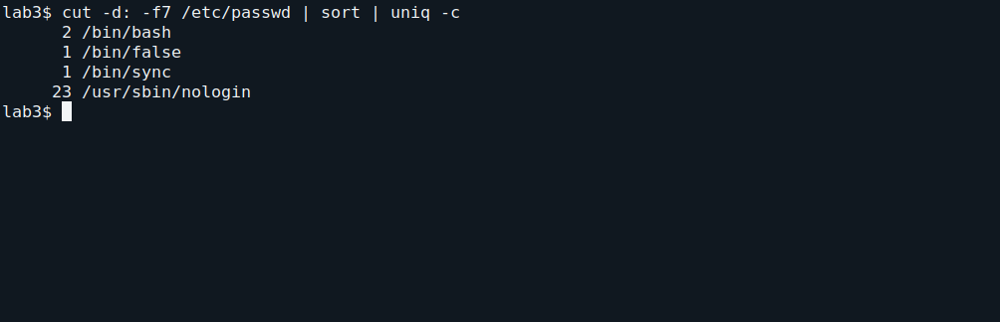

*Figure 4.7 – Login-shell counts.*

### Q8 — Normal versus long directory listing


```bash
ls /etc | wc -l; ls -l /etc | wc -l
```

Before execution, the prediction was that the long listing would add exactly one `total` line. The actual counts were **179 and 180**. Both commands omitted hidden entries; the extra long-format summary line explained the difference.

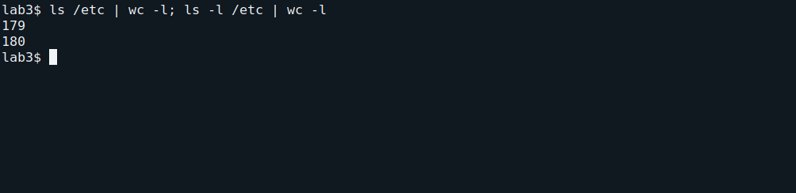

*Figure 4.8 – Normal versus long directory listing.*

The full script run produced the same individual answers:

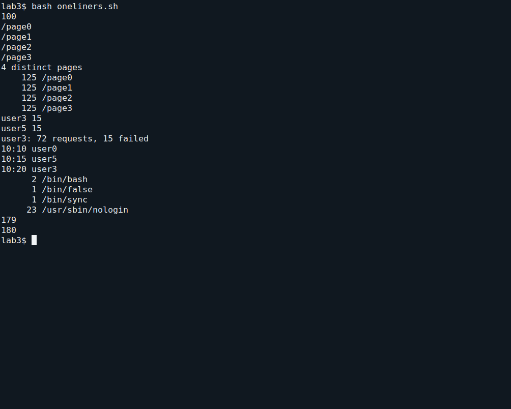

*Figure 4.9 – Complete run of oneliners.sh.*

### Additional regular-expression exercise

The expression ` 10:[0-5]0 [^ ]+ FAIL ` matches a minute ending in zero and a failed request in the correct fields. `grep -Ec` counted **50** such records; the screenshot shows their last three lines and the count.

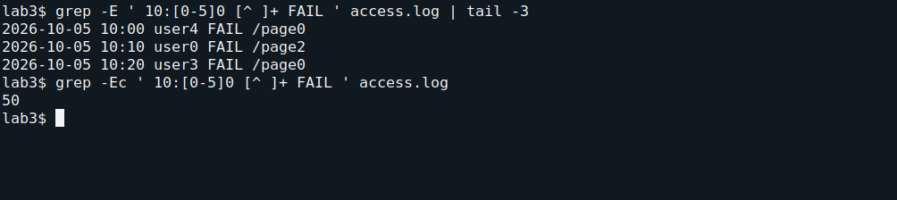

*Figure 4.10 – Failed requests at minutes ending in zero.*


## Part 5. A reusable report script

`report.sh` validates its argument and file readability, counts records, and loops over `user0` through `user6`. Its conditions compare complete user/result fields, and it handles zero matching failures without treating that as a script error.

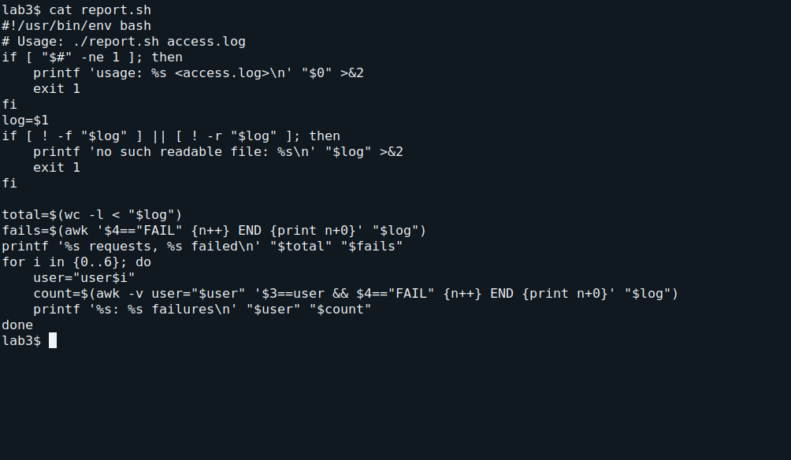

*Figure 5.1 – Complete report.sh implementation.*

### Observe 1 — Interpreter and execute permission

The handout's `#!/bin/bash` tells the kernel to execute the script with that absolute interpreter. The submitted script uses `#!/usr/bin/env bash`, which selects Bash through PATH. In both cases direct execution also needs the executable permission bit. Before `chmod +x`, the attempted `./report.sh access.log` failed with Permission denied and status 126; after the change it ran successfully.

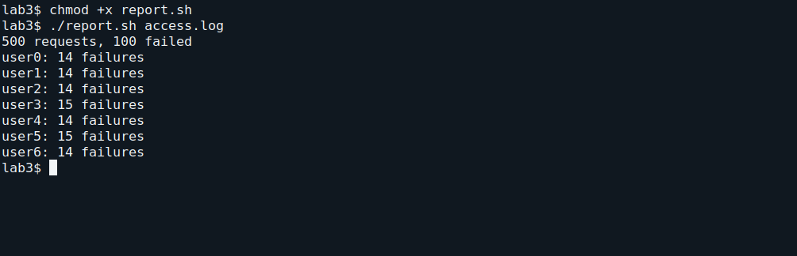

*Figure 5.2 – Making the script executable and reporting the log.*

### Observe 2 — Why the ./ prefix is necessary

The session PATH does not contain the current directory. `./report.sh` explicitly names a path relative to that directory; a bare `report.sh` would instead require a matching executable in PATH. Running `bash report.sh access.log` is another valid form because Bash opens the script as input.

### Observe 3 — Error stream and exit status

The `>&2` redirection keeps diagnostics separate from the data written to stdout. Status 1 lets another command detect failure without parsing the message. A nonexistent log produced only an error message and status 1. Additional checks confirmed the no-argument error, a valid empty file, and a valid filename containing spaces; the ordinary input produced `500 requests, 100 failed` and all seven user counts.

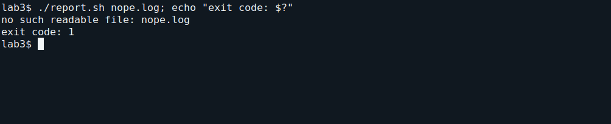

*Figure 5.3 – Missing-file diagnostic and nonzero status.*

## Conclusion

The experiments separate work done by Bash from work done by the launched programs: expansion and argument boundaries are decided before execution, while descriptors determine where the programs read and write. The log exercise also showed why exact fields and tied maxima matter: a plausible-looking pipeline can still answer a different question. Independent record counting confirmed the 500-request total, the four page totals and the 100 failures reported by the submitted scripts.

### Sources

Course handout: “Lab 3 — The Command Line: Shell, Pipes and Text Filters”. Command semantics were checked using the installed Bash help and the `ls` manual during the session.
