# Laboratory Work No. 4 — The xv6 Shell from the Outside

**Student:** Daniil Cerneaga, FAF-243  
**Supervisors:** Marius Dumitrescu; Reițman Patricia  
**Course:** Operating Systems, FCIM, Technical University of Moldova  
**Date:** 12 November 2026

## Purpose and environment

This lab compares Bash with the xv6 shell, checks the tick-waiting program against the current syscall interface, and uses an argument-printing program to expose shell expansion directly. Linux-side commands ran in Ubuntu 26.04.1 under WSL2 as `deventeex`. xv6 was built from course revision `06aad25c735fd3159bdfae5680be4eab7b1668b2` and booted in QEMU with one RISC-V hart and 128 MiB RAM. Linux compilation used GCC, and the xv6 build used the RISC-V cross-compiler.

The submission contains `user/sleep.c`, `user/args.c`, `args_linux.c` and the Makefile entries needed to build the guest programs. A fresh Bash comparison directory contained `README`, `a.c`, `b.c`, and `args_linux.c`; the Linux executable was built there with `gcc -Wall -Wextra -Werror -o args args_linux.c`.

### Sources

Course handout: “Lab 4 — The xv6 Shell from the Outside”. Implementation details and line numbers refer to [MIT xv6 at the course-pinned revision](https://github.com/mit-pdos/xv6-riscv/tree/06aad25c735fd3159bdfae5680be4eab7b1668b2), particularly `user/sh.c` and `user/user.h`.

## Part 1. Checking sleep against the current xv6 API

The header inspection found `25:int pause(int);` in `user/user.h`, so this lab's program calls `pause(ticks)` directly. It keeps the executable name `sleep`; kernel declarations and syscall implementations are unchanged. It validates the decimal tick count before making the call.

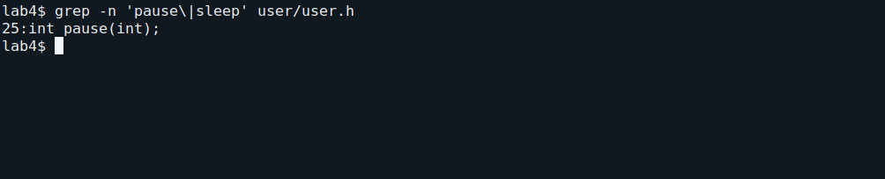

*Figure 1.1 – The pause declaration in user.h.*


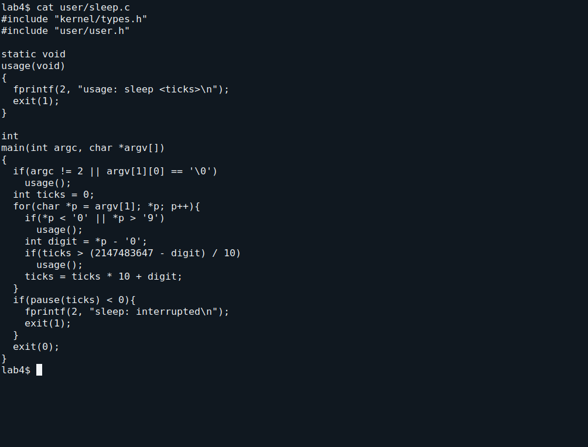

*Figure 1.2 – sleep.c using the current pause syscall.*

The Makefile registers `$U/_sleep` and `$U/_args` in UPROGS with continuation backslashes. The rebuilt image booted, `sleep 20` returned without output after waiting, and `sleep` with no argument displayed `usage: sleep <ticks>`.

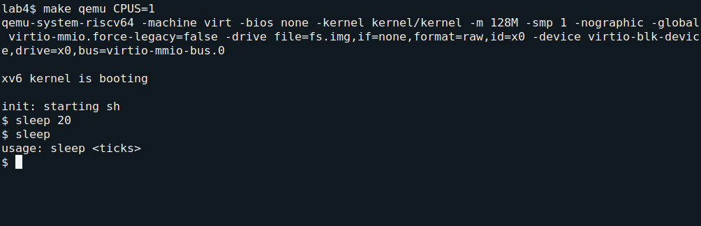

*Figure 1.3 – sleep with and without a tick argument.*


## Part 2. Bash and xv6 shell comparison

The following commands were executed in both shells. Background-output placement can depend on scheduling; its exact position does not imply that the child ran before or after the shell issued a new prompt.

| Command or keys | Bash result | xv6 result | Explanation |
| --- | --- | --- | --- |
| `echo hello > f ; cat < f` | `hello` | `hello` | Both connect file descriptors for redirection. |
| `ls \| grep READ` | `README` | A metadata row for README | Both support a pipe; their ls output formats differ. |
| `(echo a; echo b) \| wc` | 2 lines, 2 words, 4 bytes | `2 2 4` | Both support grouping, sequencing and pipes. |
| `echo one ; echo two` | one, then two | one, then two | Both implement sequential lists. |
| `echo bg &` | A job identifier and bg | bg, with no Bash-style job announcement | Both can start a child without waiting in the shell. |
| `ls *` | Names matching the test directory's entries | `ls: cannot open *` | xv6 passes the asterisk literally. |
| `echo $HOME` | `/home/deventeex` | `$HOME` | xv6 performs no variable expansion. |
| `echo "a b"` | `a b` | `"a b"` including quote characters | xv6 neither groups nor removes quotes as Bash does. |
| `mkdir d ; cd d ; ls ..` | Changes the parent shell directory and lists its parent | `exec cd failed`, then a root-directory listing | xv6 only treats cd as a built-in when it starts the input line. |
| Up, Tab, Ctrl+R | Readline history, completion and search | No corresponding editing features | xv6's console and shell do not provide Readline. |

*Table 2.1 — The commands observed in both shells.*

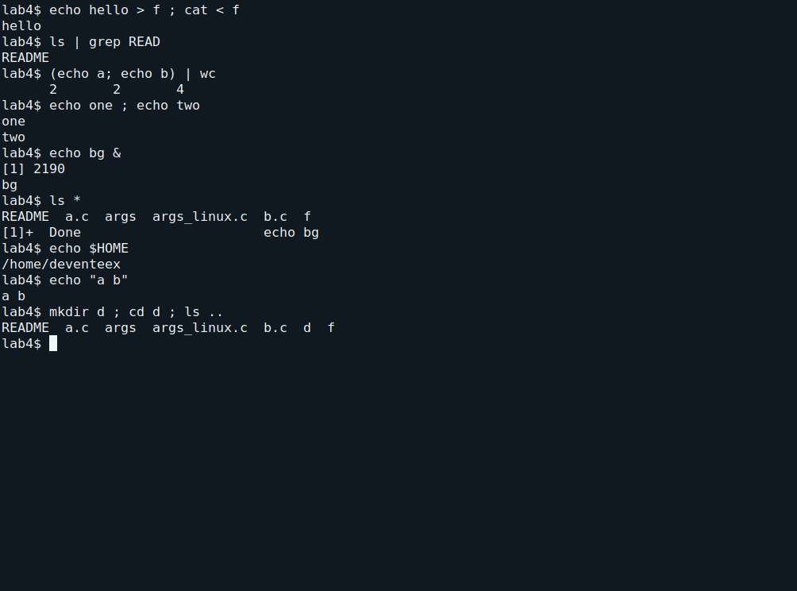

*Figure 2.1 – The comparison commands executed in Bash.*


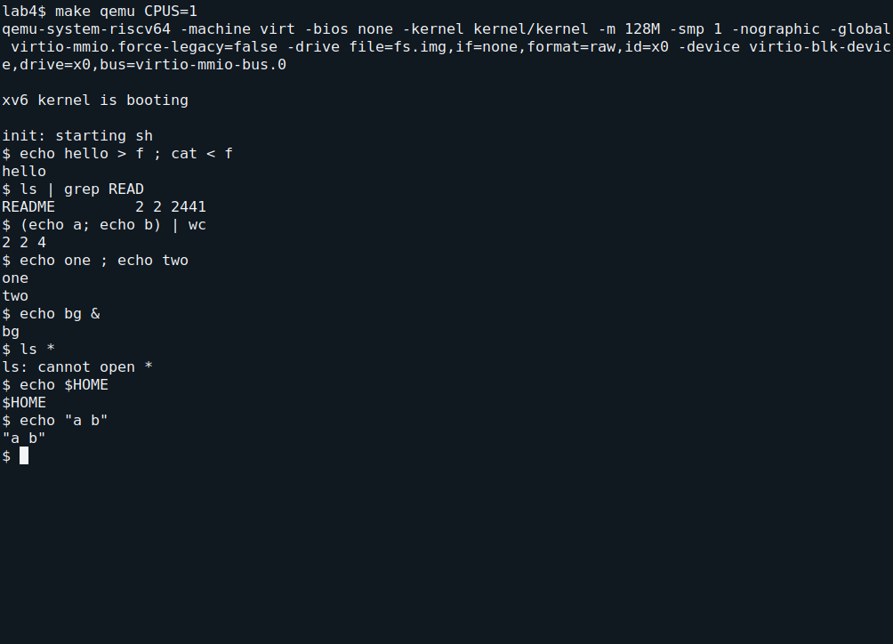

*Figure 2.2 – The same commands executed in xv6.*

### Observe 1 — Shared features and Bash additions

Both systems execute programs, connect pipes, support input/output redirection, group commands in parentheses, run sequential lists and launch background commands. Both have a parent-shell `cd` operation, but xv6's placement rule is much more restrictive. Bash adds variable and filename expansion, quote handling, PATH search, history/completion and job-control commands.

### Observe 2 — Why ls fails after changing directory

An important distinction appeared in the literal command from the table: embedded `cd d` was attempted as an external program and failed, so that command line did not actually change the xv6 shell's directory. To test the intended directory-change case, `cd d` was entered as a separate line. The subsequent `ls ..` then failed with `exec ls failed`, while `/ls ..` succeeded. The executable lives in `/`, and the xv6 shell does not search a PATH to find it from another directory.

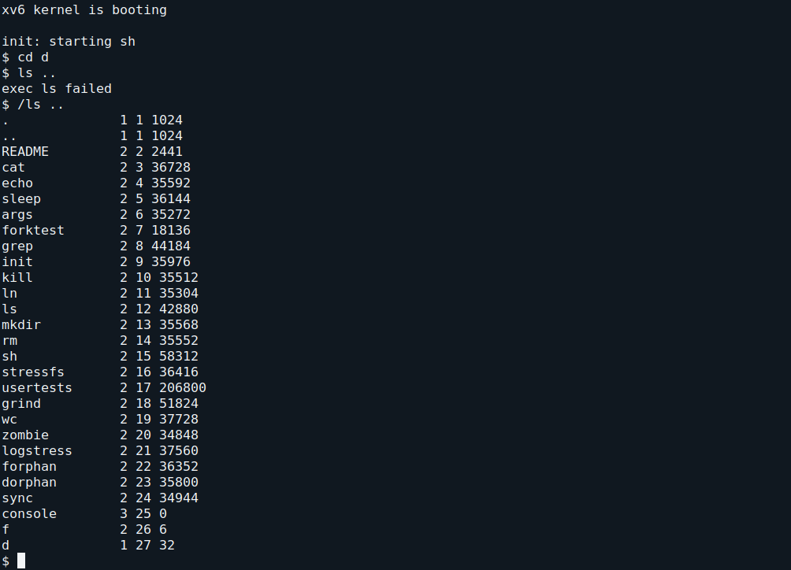

*Figure 2.3 – Standalone cd, the failed relative ls, and /ls as the alternative.*

### Observe 3 — Most useful and simplest extensions

I would miss history and completion most when repeatedly entering commands. A fixed search of `/` after a failed relative exec would be a small first improvement for this xv6 environment; a configurable PATH requires additional parsing or environment support. Implementing complete Bash-style quoting or expansion is a larger task because it changes tokenisation, argument boundaries and error handling.


## Part 3. Inspecting argc and argv

The guest and Linux versions print the same argument information. The guest version uses xv6 headers and `exit(0)`; the Linux version includes `<stdio.h>` and returns from main. Neither implementation expands filenames or interprets quote characters itself.

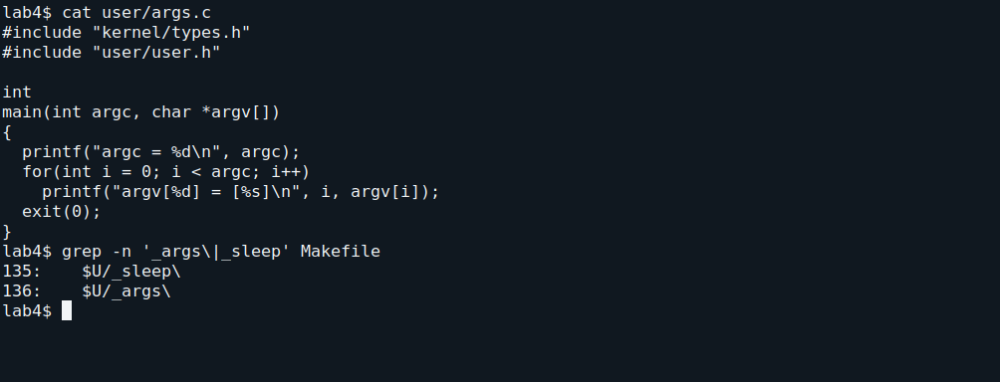

*Figure 3.1 – args.c and its UPROGS registration.*

### Observe 1 — The wildcard and quoted argument

For `args *.c "x y"`, xv6 received four arguments including argv[0]:

```text
argc = 4
argv[0] = [args]
argv[1] = [*.c]
argv[2] = ["x]
argv[3] = [y"]
```

Bash received five arguments, because the three `.c` filenames were expanded and `x y` was retained as one argument:

```text
argc = 5
argv[0] = [./args]
argv[1] = [a.c]
argv[2] = [args_linux.c]
argv[3] = [b.c]
argv[4] = [x y]
```


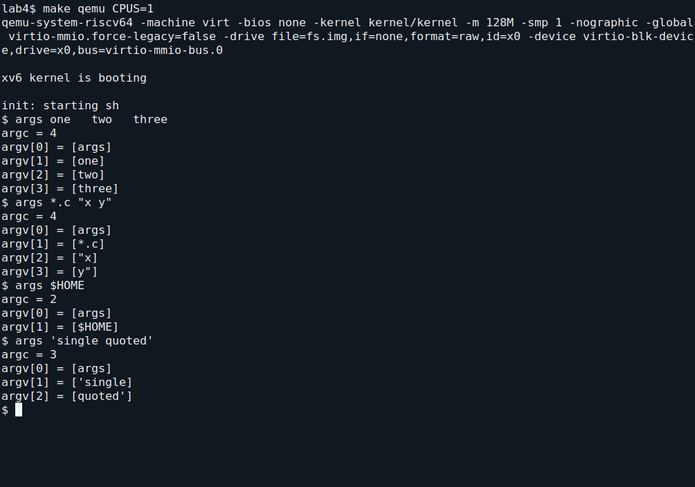

*Figure 3.2 – All four argument tests in xv6.*


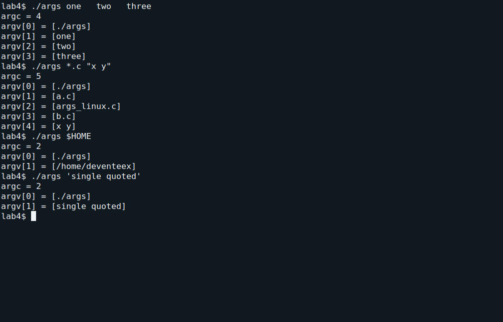

*Figure 3.3 – The corresponding argument tests in Bash.*

### Observe 2 — Who changes the argument list?

The shell performs the expansion and removes syntactic quotes before the exec request. The kernel receives the resulting argument array; the program then prints it. The matching printing logic therefore exposes a shell difference: xv6 passes `*.c`, `"x`, and `y"` as three literal arguments, while Bash passes the matched names and a single `x y` argument.

The other tests support the same conclusion. Both shells produced three user arguments from `one   two   three`. Bash expanded `$HOME`, whereas xv6 passed it literally. Bash made `'single quoted'` one argument; xv6 split it into two words and retained the outer quote characters in those words.

### Observe 3 — Extra spaces

Unquoted spaces separate words in both parsers, and multiple separators do not become empty arguments. Thus the spacing between `one`, `two` and `three` disappeared. Bash quoting can preserve spaces inside an argument, but the xv6 tokenizer has no equivalent quote state.


## Part 4. Reading the shell implementation

The checked `user/sh.c` contained **499 lines**. The source inspection used `wc -l`, `grep -n "#define"`, `grep -n "case "`, and a focused view of the command loop and tokenizer.

### Observe 1 — Five command kinds

| Kind | Trigger | Execution responsibility |
| --- | --- | --- |
| EXEC | An ordinary program and argument words | Call exec with the parsed argv. |
| REDIR | `<` or `>` | Arrange a descriptor before running the nested command. |
| PIPE | `\|` | Connect two children through a kernel pipe. |
| LIST | `;` | Finish one command before running the next. |
| BACK | `&` | Start the child without waiting for it in the shell. |

*Table 4.1 — The five execution-node types.*

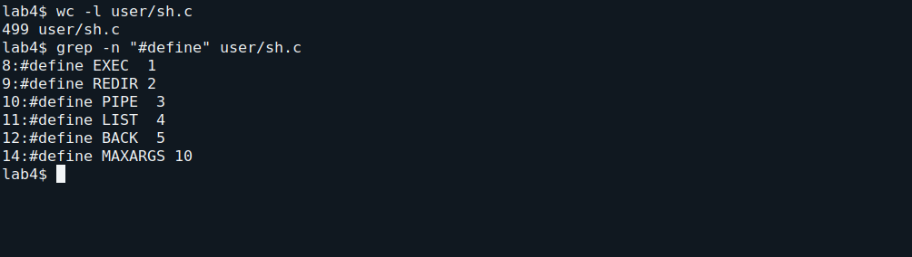

*Figure 4.1 – Command-kind definitions and the source line count.*


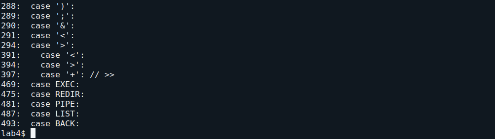

*Figure 4.2 – Execution and parsing cases in sh.c.*

### Observe 2 — Where cd runs

The main command loop examines the input string before calling `parsecmd`. At lines 166–170 it recognises the leading `cd ` and calls `chdir` in the parent. A child-only chdir would not affect the next command entered at the shell prompt. Because this test is outside the list parser, a later `cd` inside a list is treated as an EXEC node; this explains the observed `exec cd failed` rather than assuming that every command with the text cd uses the built-in.

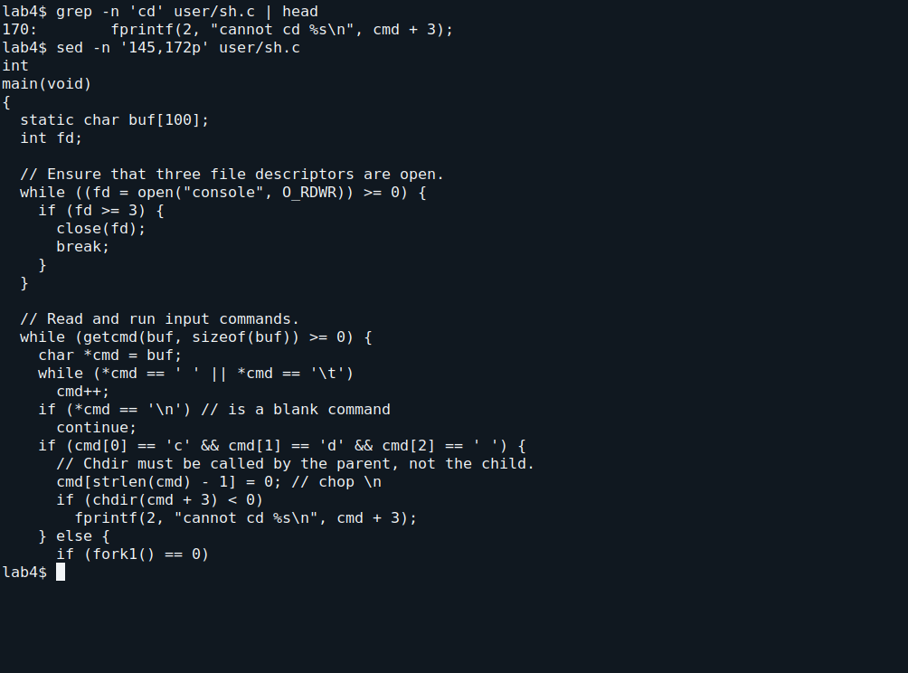

*Figure 4.3 – Parent-shell cd handling before parsecmd.*

### Observe 3 — Missing wildcard and variable handling

The tokenizer defines whitespace at line 268 and the special-symbol string `<|>&;()` at line 269. Neither `*` nor `$` has an expansion handler. Quotes also pass through as ordinary characters. This accounts for the wildcard error, literal `$HOME`, and split quoted strings measured in Parts 2 and 3.

## Conclusion

The comparison showed that executing Unix programs and connecting descriptors require far less shell code than Bash's editing and expansion features. The argv programs isolated this difference from the programs being launched: the same printing task exposed different arrays before any application-level work occurred. Reading the parent-shell cd check also resolved a subtle experimental trap: cd inside a list and cd on its own line do not behave the same way in xv6.
