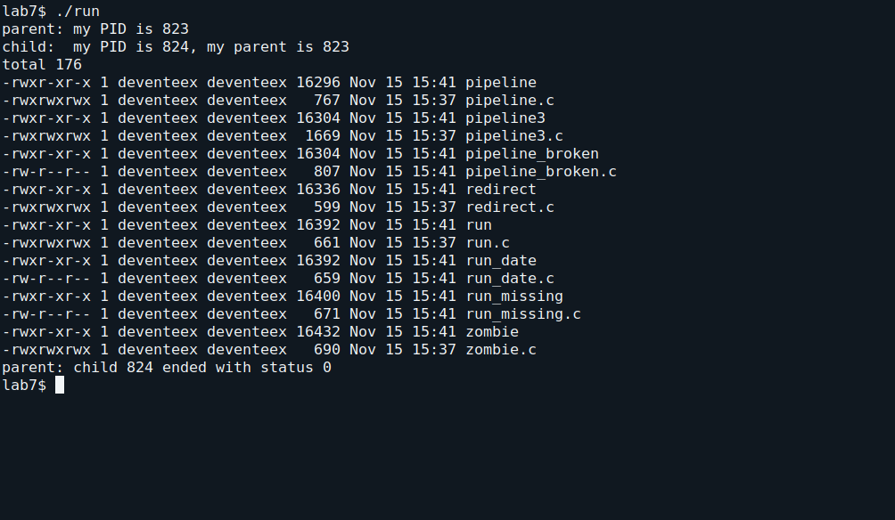
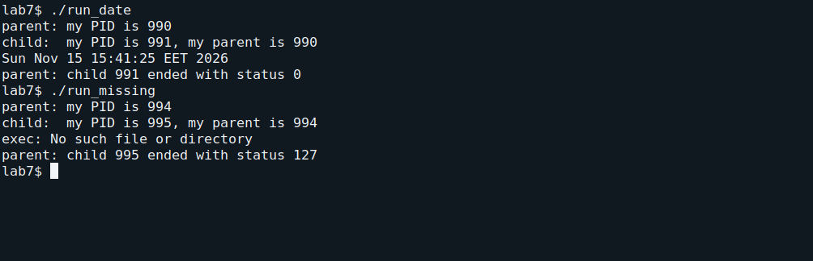
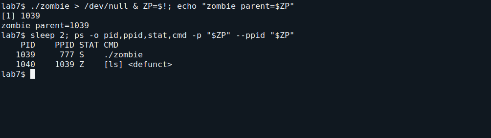
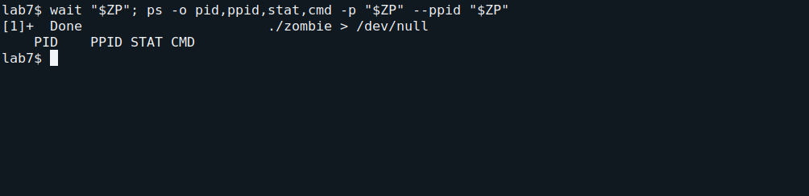
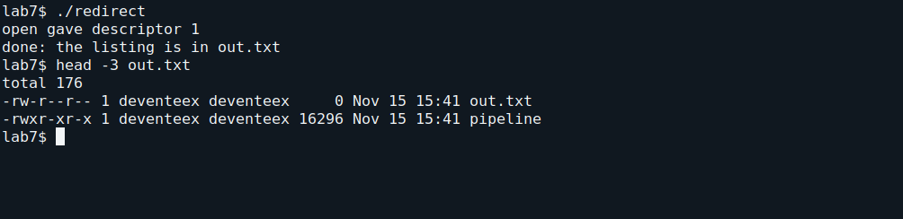
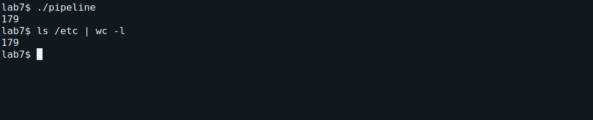
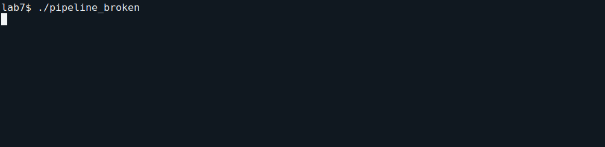
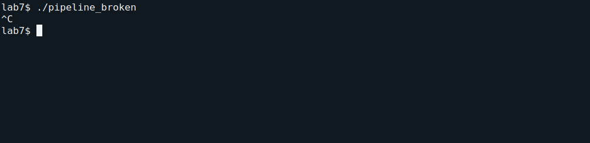
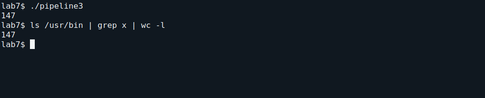

# Laboratory Work No. 7 — Three Small Programs: Processes, Redirection, a Pipe

**Student:** Daniil Cerneaga, FAF-243  
**Supervisors:** Marius Dumitrescu; Reițman Patricia  
**Course:** Operating Systems, FCIM, Technical University of Moldova  
**Date:** 15 November 2026

## Purpose and execution environment

The work reconstructs small parts of a Unix shell in C: creating a child, replacing its program, collecting its exit status, redirecting a descriptor, and connecting two processes through a pipe. A deliberate zombie and a deliberately incomplete pipe-close sequence expose the states hidden by a normal shell command.

The programs ran as the ordinary account `deventeex` in Ubuntu 26.04.1 under WSL2. Each submitted source was compiled with `gcc -Wall -Wextra -Werror`. The experiments used a fresh Linux working directory; binaries and temporary variants were not included in the submission. The recorded environment was:

```text
Linux DESKTOP-7CJE0EE 6.18.58.1-microsoft-standard-WSL2 #1 SMP PREEMPT_DYNAMIC Tue Oct 27 00:24:11 UTC 2026 x86_64 GNU/Linux
gcc (Ubuntu 15.2.0-16ubuntu1) 15.2.0
```

The four required source files follow the handout's fork/exec/wait, close/open and close/dup demonstrations. `pipeline3.c` implements the optional three-stage extension. Successful run, date and missing-program variants were tested separately, and the submitted `run.c` remains the original ls version.

## Part 1. fork, exec and wait

`run.c` prints its PID and flushes stdout before fork. The child prints its own identity and parent's PID, then invokes `execlp("ls", "ls", "-l", NULL)`. The parent waits for that specific child and decodes its normal exit status with WEXITSTATUS. These process-related lines came from the first run; directory-listing rows are omitted in this text excerpt:

```text
parent: my PID is 823
child:  my PID is 824, my parent is 823
parent: child 824 ended with status 0
```




*Figure 1.1 – The child executes ls before the parent reports completion.*

The exercise then replaced the exec line with date, followed by nosuchprog. The date variant completed with child status 0; the missing-program variant printed the exec error and child status 127.



*Figure 1.2 – Successful date execution and a failed exec.*

### Observe 1 — Why the error line runs only after a failed exec

A successful exec replaces the child's program image, so execution never reaches the old instruction following execlp. On failure, execlp returns -1 and preserves the calling program; perror can then describe the failure, and the explicit `exit(127)` terminates that child. The same PID changes program identity on a successful exec; exec does not create a second child.

### Observe 2 — The child's parent number

The first parent PID was **823**, and its child was **824**. The child printed `my parent is 823`, obtained with getppid. This is the PID of the running parent instance of run, rather than the PID of the shell that originally launched it. Other runs naturally received different PIDs.

### Observe 3 — The status reported by the parent

The ls child returned **0** and the missing-program child returned **127**. These are the child's decoded exit values, not the raw integer wait status. In the supplied demonstration, the parent prints that value and then returns 0 itself; therefore a displayed child failure does not imply that the wrapper executable also returns 127. The 127 is selected by the child's error branch.

## Part 2. A zombie before waitpid

`zombie.c` keeps the successful ls version but sleeps for 20 seconds immediately before waitpid. It was launched in the background, inspected after two seconds, and inspected again after the background parent completed. The first process-table snapshot showed:

```text
PID    PPID STAT CMD
   1039     777 S    ./zombie
   1040    1039 Z    [ls] <defunct>
```




*Figure 2.1 – A sleeping parent and its Z-state ls child.*

### Observe 1 — What the Z state means

PID **1040** appeared as `Z [ls] <defunct>` below parent **1039**. The child had finished executing; the kernel retained its exit information until its parent collected it. It was not a running process consuming CPU instructions and was not another sleep process.

### Observe 2 — What removed the zombie

The later snapshot contained only the heading, with no defunct child. **`waitpid(pid, &status, 0)`** in zombie.c collected the child and removed that retained process-table entry. `sleep(20)` merely delayed the collection; it did not reap the child. The shell's subsequent wait collected the background parent as well. The recorded interval from launch through completion was approximately **20.21 seconds**.



*Figure 2.2 – No zombie remains after the parent and shell waits complete.*

## Part 3. Redirection without changing ls

The redirect program closes descriptor 1, opens out.txt with create/write/truncate flags, and then execs ls. The diagnostic is written to stderr, while the directory listing goes to the newly opened file.

```text
open gave descriptor 1
done: the listing is in out.txt
$ head -3 out.txt
total 176
-rw-r--r-- 1 deventeex deventeex     0 Nov 15 15:41 out.txt
-rwxr-xr-x 1 deventeex deventeex 16296 Nov 15 15:41 pipeline
```




*Figure 3.1 – Descriptor 1 is reused and the listing is stored in out.txt.*

### Observe 1 — Which descriptor open returned

It returned **1**. Closing stdout made 1 the lowest unused descriptor in the child; open selected that slot. This demonstration assumes descriptors 0 and 2 are still open, as they were in the tested shell environment.

### Observe 2 — Why the listing disappeared from the screen

ls still writes to its standard output, descriptor 1. The descriptor now refers to out.txt and survives exec, so the kernel routes those bytes to the file. The program did not need to know that its caller changed the descriptor table. Its out.txt row can initially show size 0 because ls gathered that metadata before writing the listing into the file.

### Observe 3 — Redirecting errors instead

Closing **descriptor 2** before opening err.txt would direct the subsequent program's standard error to that file, assuming 2 is then the lowest unused slot. Using dup2 is the usual general-purpose alternative when a program must target a specific descriptor without that assumption; this exercise deliberately demonstrates close followed by lowest-free allocation.

## Part 4. A two-process pipe

`pipeline.c` creates one pipe and two children. After duplication, each child closes both original pipe descriptors, and the parent also closes them before waiting.

| Process | Descriptor 0 | Descriptor 1 | Original pipe ends |
| --- | --- | --- | --- |
| ls child | Original stdin | Duplicate of p[1] | Both closed after dup. |
| wc child | Duplicate of p[0] | Original stdout | Both closed after dup. |
| Parent | Original stdin | Original stdout | Both closed before waiting. |

*Table 4.1 — Descriptor connections for ls /etc followed by wc -l.*



*Figure 4.1 – The program and shell pipeline produce the same count.*

### Observe 1 — Comparison with the real shell

Both `./pipeline` and `ls /etc | wc -l` printed **179**. This is the directory-entry count observed on this system, not a constant that every Linux installation must reproduce. Independent runs of the program and shell command agreed.

### Observe 2 — Which child remained blocked after the deliberate change

The test version omitted only the parent's `close(p[1])`. The ls child finished, but **wc** did not. An external process-table inspection confirmed wc waiting in the pipe-read path while its parent waited for a child:

```text
PID    PPID STAT WCHAN                    CMD
   1524     777 S+   do_wait                  ./pipeline_broken
   1526    1524 S+   anon_pipe_read           wc -l
```




*Figure 4.2 – The intentionally broken pipeline has not returned a shell prompt.*

### Observe 3 — What wc was waiting for

wc was waiting for **end-of-file**, which a pipe reader receives only after every write reference is closed. The parent still held an unused write descriptor, so no bytes were arriving but EOF was not yet possible. Ctrl+C stopped the foreground job; the submitted pipeline.c keeps the required close in place.



*Figure 4.3 – Ctrl+C stops the deliberately blocked test version.*

## Optional extension. Three stages

`pipeline3.c` uses two pipes and three children for `ls /usr/bin | grep x | wc -l`. Each child duplicates only the ends needed by its stage and closes all four original descriptors. The parent closes its copies and collects all three child statuses. The program and the shell both counted **147** matching names in this run.



*Figure 5.1 – The three-stage implementation agrees with Bash.*

## Additional error checks

The final sources check failed forks, descriptor duplication and waits. Interrupted waits are retried, and WEXITSTATUS is used only after WIFEXITED confirms a normal exit. Tests with forced fork/dup failures, missing executables, an invalid output target and a child terminated by a signal passed. Redirection reports completion only when its child succeeds; both pipelines collect their children and report a nonzero status if a stage fails.

## Conclusion

fork creates the child, exec changes the program within that child, and wait collects the information left when it exits. Redirection and pipelines then change descriptor connections without changing the programs' I/O code. The deliberately broken pipe demonstrated a particularly important lifetime rule: an unused descriptor still counts as a writer until it is closed, and can prevent a reader from ever receiving EOF.

### Sources

Course handout: “Lab 7 — Three Small Programs: Processes, Redirection, a Pipe”. The required programs follow its examples, with the requested exec variants and deliberate close omission executed as separate experiments; pipeline3 is the optional extension.
