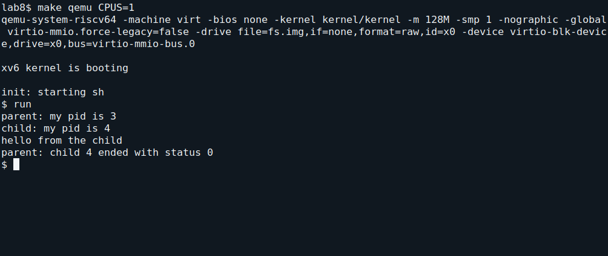
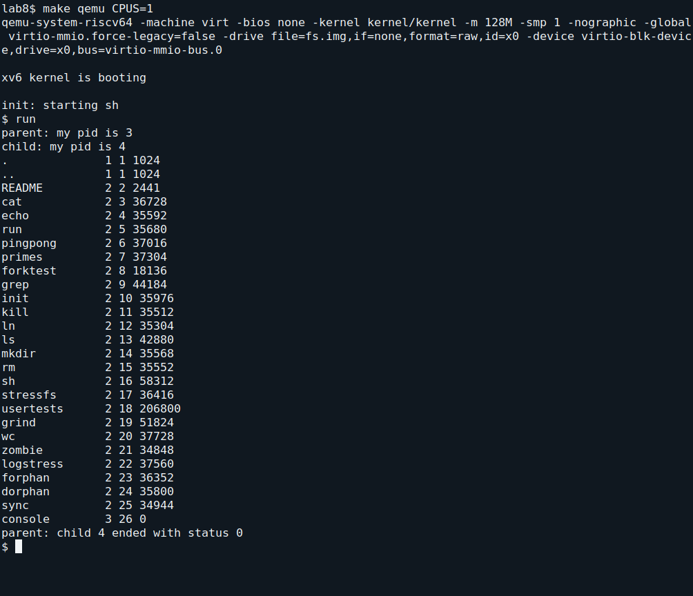
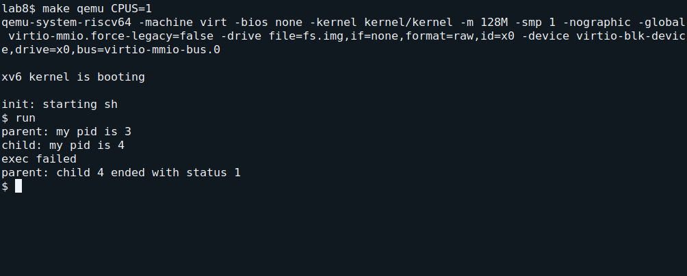
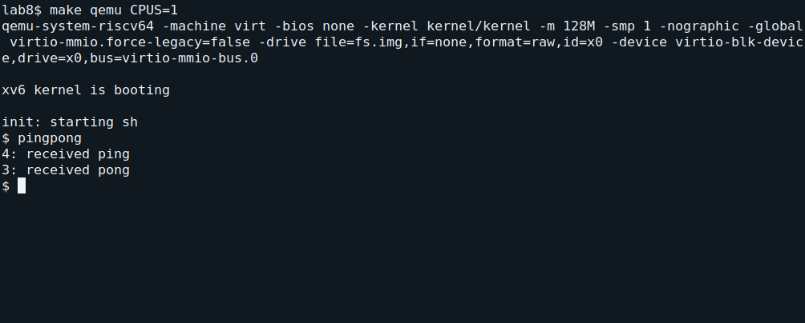
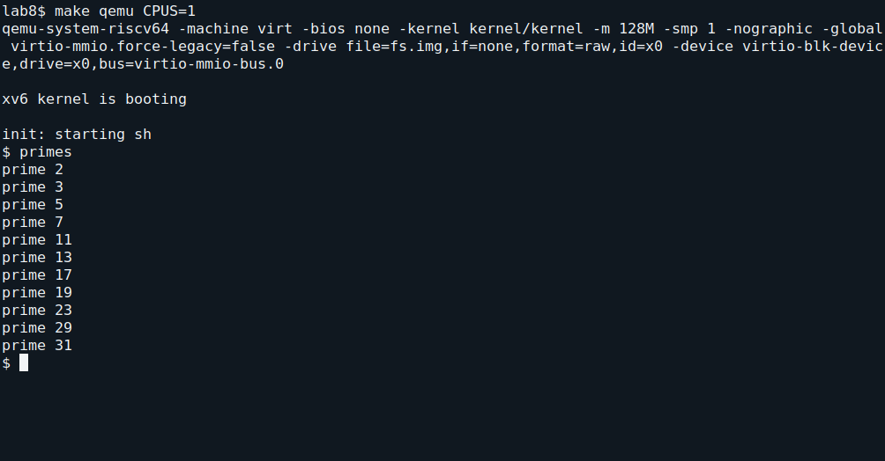

# Laboratory Work No. 8 — The Same Calls, Inside Your Own OS

**Student:** Daniil Cerneaga, FAF-243  
**Supervisors:** Marius Dumitrescu; Reițman Patricia  
**Course:** Operating Systems, FCIM, Technical University of Moldova  
**Date:** 15 November 2026

## Purpose and environment

This lab repeats the Linux process-creation exercise inside the xv6 kernel built for the course, then uses two pipes to exchange a byte between a parent and a child. The optional primes program connects a chain of filter processes.

The source tree was extracted from course revision `06aad25c735fd3159bdfae5680be4eab7b1668b2`. It was built with RISC-V GCC 15.2.0 and executed in QEMU 10.2.1 with one hart and 128 MiB RAM, hosted by Ubuntu 26.04.1 under WSL2. The submitted Makefile registers run, pingpong and primes in UPROGS; the kernel and user headers remain unchanged. The short Observe answers are also collected in notes.md.

## Part 1. The run program in xv6

The parent prints its PID, calls fork, and waits. In the child, the original program prints the child's PID and then calls exec with the echo pathname and argument array. The first run produced:

```text
$ run
parent: my pid is 3
child: my pid is 4
hello from the child
parent: child 4 ended with status 0
```




*Figure 1.1 – The echo child and successful xv6 wait status.*

A second build changed the child to execute ls. The resulting directory listing appeared between the child's identity line and the parent's final status line, with status 0. A third build deliberately requested nosuchprog, then the final build restored the echo implementation submitted in user/run.c.



*Figure 1.2 – The child program changed from run to ls.*




*Figure 1.3 – Failed exec returns to the child error branch.*

### Observe 1 — The three calls on the two systems

| Purpose | Linux version from Lab 7 | xv6 version |
| --- | --- | --- |
| Create the child | fork() | fork() |
| Replace the child program | execlp(...) | exec(path, argv) |
| Collect its status | waitpid(pid, &status, 0) | wait(&status) |

*Table 1.1 — The same process lifecycle through two APIs.*

The lifecycle is the same, but Linux's execlp is a libc convenience interface that searches PATH, while xv6 exec receives an explicit pathname and argument array. The xv6 wait interface has no pid argument and writes the child's exit value directly; the Linux example uses WEXITSTATUS to decode its wait status. The handout calls these the three steps even though their wrapper interfaces differ.

### Observe 2 — Who prints hello from the child

**echo** prints the greeting. The run code prints the identity lines, but successful exec discards its program image and starts echo in the existing child process. The instruction after exec is reached only in the failed-exec experiment.

### Observe 3 — Why the failure statuses differ

The xv6 error branch explicitly calls **exit(1)**, whereas the Linux error branch explicitly calls **exit(127)**. The kernels are reporting the values selected by those programs, not imposing different universal exec-failure numbers. In both demonstrations the parent continues after wait and returns its own success status after printing the child result.

## Part 2. A byte travelling in both directions

`pingpong.c` creates `p2c` and `c2p`, checks creation/fork/I/O results, and closes unused ends in each process. The parent writes byte p to p2c; the child reads it, prints its PID and received ping, then writes the same byte to c2p. The parent reads and validates the reply, prints received pong, and checks the child's wait status.

```text
$ pingpong
4: received ping
3: received pong
```




*Figure 2.1 – The child ping line precedes the parent pong line.*

### Observe 1 — Why two pipes

A pipe provides a one-way byte stream. Two pipes give the request and reply distinct channels: parent-to-child and child-to-parent. Trying to make both directions use the same stream would not identify the intended receiver; a process could consume the byte it just wrote. Closing unused ends also makes EOF and error behaviour meaningful.

### Observe 2 — The operation that waits for the reply

The parent's **read(c2p[0], &byte, 1)** blocks until a byte is available, or the stream closes/fails. This synchronization happens before the explicit wait call. The child prints its ping line before writing the reply, so the parent cannot print pong first on a successful exchange. wait later collects the child's termination status.

The demonstrated PIDs were child 4 and parent 3. Twenty additional pingpong executions all preserved the required ordering and completed. A separate observer then executed run, pingpong and primes and confirmed exit status **0** for all three programs.

## Optional extension. A process sieve

The first process sends the integers 2 through 35. A filter reads its first number as a prime, prints it, and passes only nonmultiples to a new pipe and child. Each stage closes the old input in the child, closes unused pipe ends, and waits for its downstream child. Closing the final writer supplies EOF and lets the process chain finish.

```text
$ primes
prime 2
prime 3
prime 5
prime 7
prime 11
prime 13
prime 17
prime 19
prime 23
prime 29
prime 31
```




*Figure 3.1 – The process chain prints exactly the primes from 2 through 35.*

The output was compared with the independent expected sequence **2, 3, 5, 7, 11, 13, 17, 19, 23, 29, 31**. It contained all 11 primes in ascending order and no additional values. The fixed upper limit is 35, as requested by the optional exercise.

## Conclusion

The Linux and xv6 programs use the same create/replace/wait model even though their APIs differ. The pipe exchange adds synchronization through blocking reads rather than timing assumptions or sleeps. The sieve extends that idea into a chain, where closing every unneeded descriptor is essential both to resource use and to delivering EOF downstream.

### Sources

Course handout: “Lab 8 — The Same Calls, Inside Your Own OS”. Interfaces and build integration were checked against [MIT xv6 at the course-pinned revision](https://github.com/mit-pdos/xv6-riscv/tree/06aad25c735fd3159bdfae5680be4eab7b1668b2).
