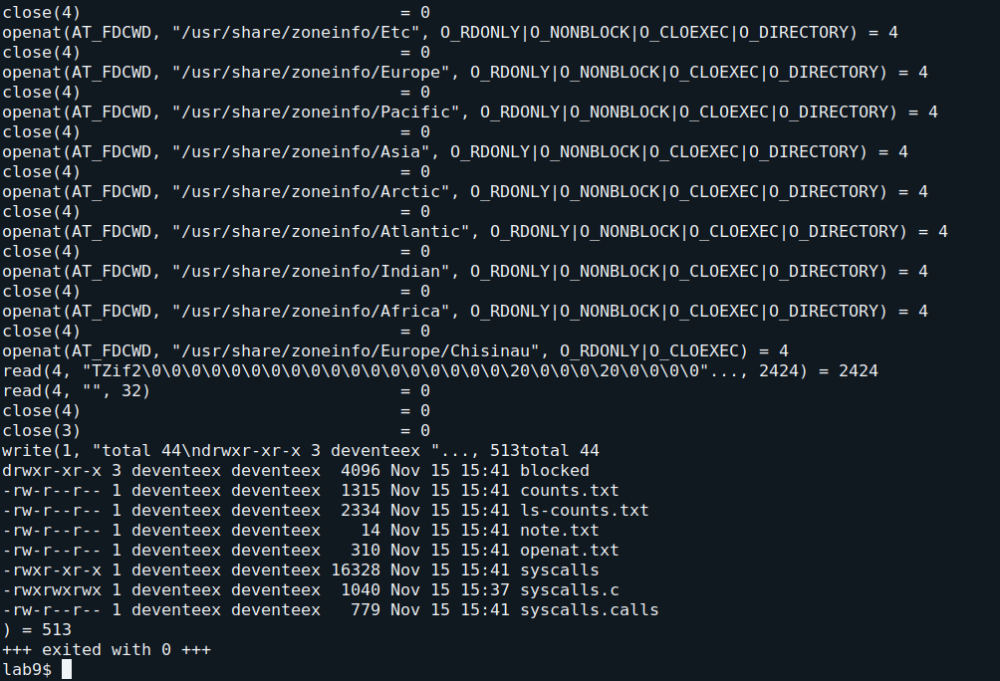
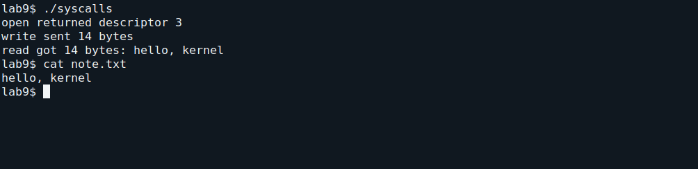
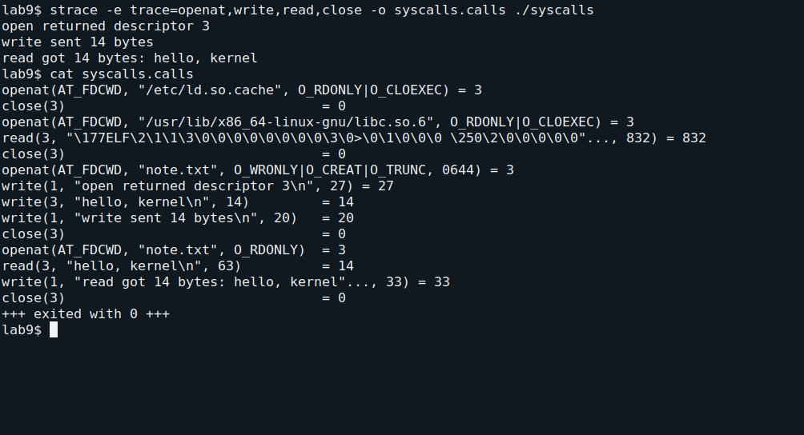
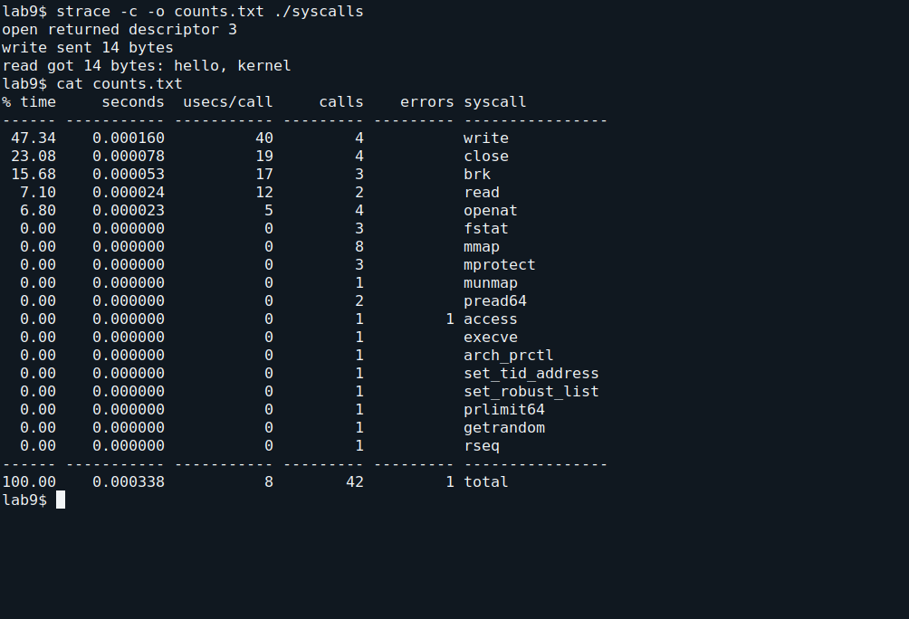
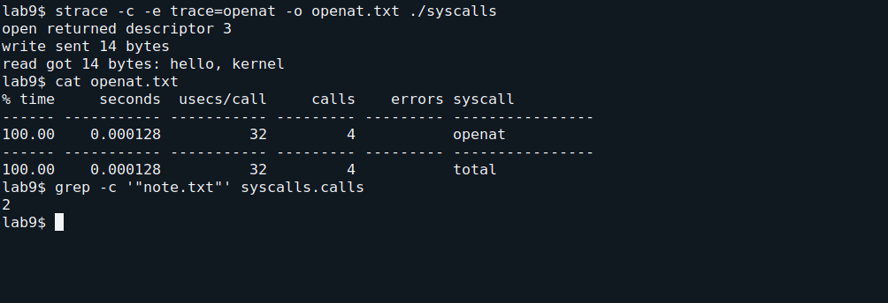

# Laboratory Work No. 9 — Watching System Calls with strace

**Student:** Daniil Cerneaga, FAF-243  
**Supervisors:** Marius Dumitrescu; Reițman Patricia  
**Course:** Operating Systems, FCIM, Technical University of Moldova  
**Date:** 15 November 2026

## Purpose and environment

The experiments observe the boundary between a Linux program and its kernel using strace. A real directory listing is traced first, followed by a small C program that opens a file, writes a line and reads it back. The final part counts calls and separates application file operations from loader and reporting activity.

The work ran as `deventeex` in Ubuntu 26.04.1 under WSL2, with GCC 15.2.0 and strace 6.19. The kernel was Linux `6.18.58.1-microsoft-standard-WSL2`. The program was compiled with `gcc -Wall -Wextra -Werror -o syscalls syscalls.c`. Screenshots came from an actual xterm session; the standard output of the program was a terminal during the syscall-count experiment.

## Part 1. Watching ls call the kernel

The requested filtered command was executed:

```bash
strace -f -e trace=openat,read,write,close ls -l
```

The filter restricts the displayed call families; it does not make those the only calls executed by ls. Startup and pathname processing produced opens, reads and closes before the listing was written. A separate full-count run, `strace -c -o ls-counts.txt ls -l >/dev/null`, measured **288 calls** in this working directory and environment. That is the rough scale observed here, not a universal count for all implementations of ls, directory sizes or output destinations.



*Figure 1.1 – Filtered kernel calls alongside the real ls listing.*

### Observe 1 — Printing the listing

The listing reached the terminal through **write on descriptor 1**, standard output. The preceding library and file activity used other descriptors. Redirecting descriptor 1 changes the destination without changing the program's idea of stdout, as Lab 7 demonstrated.

## Part 2. Explicit file I/O in syscalls.c

The source creates or truncates note.txt with mode 0644, writes `hello, kernel` followed by a newline, closes the descriptor, reopens it read-only, and reads up to 63 bytes into a 64-byte buffer. It appends the C-string terminator only after checking that read did not fail. printf reports the results, but the file contents themselves pass through open/write/read/close.

The submitted version also checks the second open, negative read results, incomplete writes and close failures. These checks keep the example from using a negative read result as an array index. The ordinary run produced:

```text
open returned descriptor 3
write sent 14 bytes
read got 14 bytes: hello, kernel
```




*Figure 2.1 – The 14-byte write/read round trip and resulting file.*

Tracing the same program with `strace -e trace=openat,write,read,close` showed the following relevant operations. The text excerpt omits the interleaved stdout-reporting writes and loader activity:

```text
openat(AT_FDCWD, "note.txt", O_WRONLY|O_CREAT|O_TRUNC, 0644) = 3
write(3, "hello, kernel\n", 14) = 14
close(3) = 0
openat(AT_FDCWD, "note.txt", O_RDONLY) = 3
read(3, "hello, kernel\n", 63) = 14
close(3) = 0
```

*Listing 2.1 — Application file operations selected from the actual trace.*

The C open wrapper becomes **openat** on this Linux/libc combination. The requested read capacity was 63, but only 14 file bytes were available. The extra terminating NUL belongs to the C buffer and was not an additional byte read from the file. An independent byte comparison confirmed all 14 bytes, including the final newline.



*Figure 2.2 – The file operations and stdout reports in one filtered trace.*

### Observe 2 — Why the first application descriptor was 3

Descriptors **0, 1 and 2** were already open as stdin, stdout and stderr, inherited from the shell. After loader setup released its temporary files, 3 was the lowest unused number, so openat on note.txt returned it. Closing and reopening the file let the kernel reuse 3. Those numbers identify descriptor-table slots; they are not global file identifiers.

As an additional check, a child shell closed only its stdin before launching the program:

```text
open returned descriptor 0
write sent 14 bytes
read got 14 bytes: hello, kernel
```

The first open then returned **0**, and the file round trip still succeeded. This confirms the lowest-free-slot rule rather than treating 3 as a fixed property of open. The parent interactive shell's stdin was unaffected by that child-only change.

## Part 3. Counting calls

`strace -c -o counts.txt ./syscalls` collected a complete summary while the program's output remained attached to the terminal. Its **42 calls**, across **18 call names**, included startup, file I/O and reporting. The main file-I/O families were:

| Call | Count | What the count includes |
| --- | --- | --- |
| openat | 4 | Two loader opens and two opens of note.txt. |
| close | 4 | The corresponding loader and note.txt closes. |
| read | 2 | One loader ELF read and one application file read. |
| write | 4 | One write to note.txt and three line-buffered stdout reports. |
| mmap | 8 | Address-space mappings during program startup. |
| Other calls | 20 | Remaining loader, memory, descriptor and process setup calls. |

*Table 3.1 — Counts from the terminal-attached summary run.*



*Figure 3.1 – The complete syscall-count summary.*

The table's Other row excludes the five individually listed call families: `42 - (4 + 4 + 2 + 4 + 8) = 20`. The summary recorded one failed access call, while the program itself exited successfully. A failed individual probe in startup is not the same thing as an application failure.

To count only one family, `strace -c -e trace=openat -o openat.txt ./syscalls` was run separately. It counted **4 openat calls**. Matching `"note.txt"` in the complete filtered trace found **2** of them; the other two opened `/etc/ld.so.cache` and `/usr/lib/x86_64-linux-gnu/libc.so.6` during loading.



*Figure 3.2 – Four openat calls in total, two concerning note.txt.*

These counts describe the recorded input, libraries and output mode. In particular, moving stdout from a terminal to a file or pipe can change printf buffering and therefore the number of write calls. Time percentages in strace summaries also vary and are not used as a performance benchmark here.

## Error-path verification

A separate directory contained a directory named note.txt. Launching syscalls there made the first open fail with `Is a directory`, and the program exited with status 1. It did not continue with an invalid descriptor or attempt to terminate a buffer at a negative index. The successful test also verified the exact 14 bytes on disk and the two note.txt opens in the raw trace.

## Conclusion

strace exposed both the requested file operations and the less visible work needed to load and report from a small program. Descriptor reuse followed the lowest-free-number rule, while syscall counts depended on more than the number of C file-I/O statements. Separating all opens from opens of note.txt avoided attributing the loader's work to the application algorithm.

### Sources

Course handout: “Lab 9 — Watching System Calls with strace”. The commands, return values and counts above come from the program and tracer executed on the stated environment.
